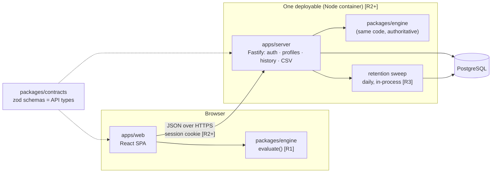
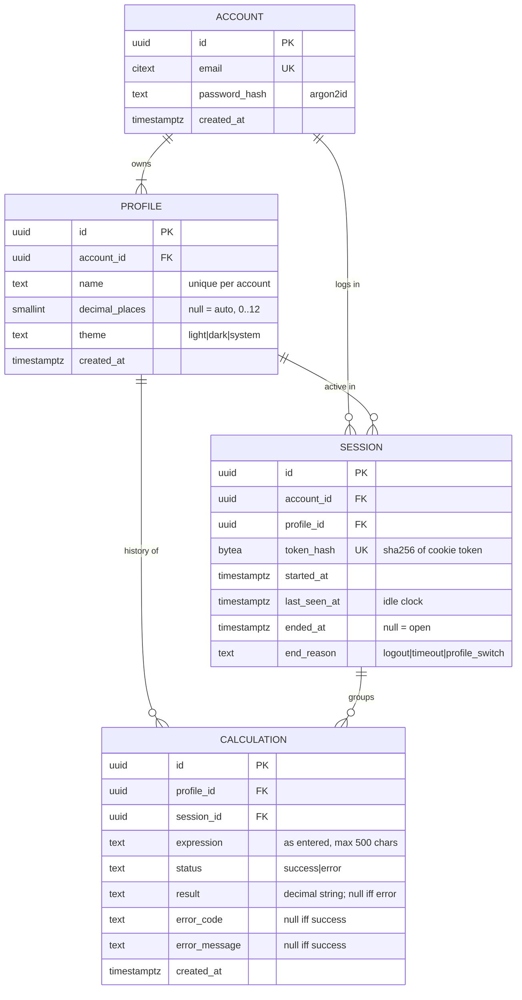
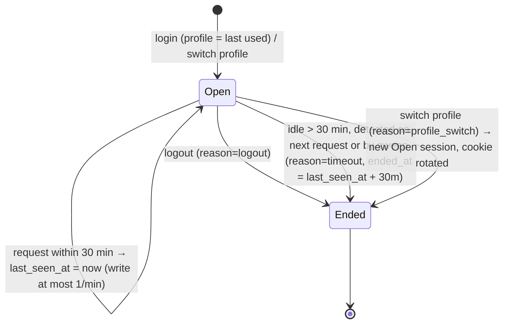

# Calculator Web – Architecture

Status: **Proposed (In Review)** · Owner: Architect · Scope: whole roadmap (R1–R4), R1 (#1, #2) first.
Decisions: [ADR 0001 stack](adr/0001-stack-and-repo-layout.md) · [0002 evaluation](adr/0002-expression-evaluation.md) · [0003 auth/sessions](adr/0003-auth-and-profile-sessions.md) · [0004 history/retention](adr/0004-history-storage-and-retention.md)

Legend: **[R1]** build now · **[R2]** accounts/profiles · **[R3]** sessions/history · **[R4]** polish

## 1. System shape



- **R1 is client-only**: `engine` + `web`, deployed as static files. No server, no DB.
- **R2+** adds one Node service that serves the API *and* the built SPA (same origin → no CORS), plus Postgres.
- One engine, two call sites: browser for instant display, server for the stored (authoritative) result. Shipped in one image, so versions cannot drift.

## 2. Stack

| Concern | Choice | Why (one line) |
|---|---|---|
| Language | TypeScript (strict) everywhere | One type system across engine, UI, API, DB. |
| Repo | pnpm workspaces monorepo | Engine/contracts shared without publishing. |
| UI | React + Vite | Boring, fast, huge a11y ecosystem (R4 #11). |
| Numbers | `decimal.js` (precision 34) | Decimal, not binary float: `0.1+0.2 = 0.3`; ≥12 sig. digits (#1). |
| API | Fastify | Small, fast, schema-first, pino logging built in. |
| Validation | zod in `packages/contracts` | Parse at every boundary; TS types derived from schemas. |
| DB | PostgreSQL 16 + Drizzle ORM/migrations | Relational fits; DB types derived from schema; `interval '1 month'`. |
| Passwords | argon2id | OWASP-recommended. |
| Tests | Vitest (unit) · Playwright (e2e, 4 browsers) · axe (a11y) | Matches DoD. |
| CI | GitHub Actions: typecheck, lint, test, e2e | Scaffold first. |

## 3. Repo layout

```
apps/web/            React SPA                         [R1]
packages/engine/     tokenizer+parser+evaluator+format [R1]  (exports: evaluate, format, types ONLY)
apps/server/         Fastify API + static SPA          [R2]
packages/contracts/  zod request/response schemas      [R2]
docs/                ARCHITECTURE.md, adr/
```
Internals are blocked via package.json `"exports"`; importing `engine/src/parser` from outside fails the build.

## 4. Data model [R2+]



Invariants (enforced in DB, mirrored in types):
- `CHECK ((status='success' AND result IS NOT NULL AND error_code IS NULL) OR (status='error' AND result IS NULL AND error_code IS NOT NULL AND error_message IS NOT NULL))`.
- `calculation.session.profile_id = calculation.profile_id` (composite FK `(session_id, profile_id) → session(id, profile_id)`), so an entry can never land in a non-active profile (#6).
- Every account has ≥1 profile: signup creates `Default`; deleting the last profile is rejected.
- Indexes: `calculation(profile_id, created_at DESC)`, `session(token_hash)`, `session(last_seen_at) WHERE ended_at IS NULL`.
- ON DELETE CASCADE: account → profiles → sessions/calculations.

### Session lifecycle (one session = one login on one profile) [R2, grouping used in R3]


Timeout ⇒ 401 ⇒ user logs in again (accounts required, no guest).

### Retention (#8) [R3]
- Single constant `RETENTION = interval '1 month'` in one SQL module.
- **Read path** always filters `created_at >= now() - RETENTION` (correct even if the job is late).
- **Sweep** daily + on boot, guarded by `pg_try_advisory_lock` (idempotent, safe with N replicas): delete calculations older than RETENTION, then sessions whose `coalesce(ended_at, last_seen_at)` is older than RETENTION; close stale open sessions. Logs counts.

### CSV export (#10) [R4]
`GET /api/calculations.csv?q=…` reuses the **same** list query as the history UI (so filter semantics are identical), streams rows, RFC 4180 quoting, columns `expression,result,status,error_message,created_at,session_id`, and, in the free-text columns only (`expression`, `error_message`; `result` is a typed `DecimalString` and stays untouched), prefixes cells starting with `= + - @ \t \r` with `'` (CSV-injection guard; see open question 5).

## 5. Core types

```ts
// ---- shared brands ----
type Brand<T, B extends string> = T & { readonly __brand: B };
export type DecimalString = Brand<string, "DecimalString">;   // canonical decimal, e.g. "-12.5"
export type AccountId = Brand<string, "AccountId">;
export type ProfileId = Brand<string, "ProfileId">;
export type SessionId = Brand<string, "SessionId">;
export type CalculationId = Brand<string, "CalculationId">;
export type Email = Brand<string, "Email">;                   // lower-cased, validated once

// ---- packages/engine [R1] — the only public surface ----
export type CalcErrorCode =
  | "syntax"          // unbalanced parens, dangling operator, bad number
  | "divide_by_zero"  // #1
  | "overflow"        // |x| beyond range
  | "domain"          // R4: log(-1), sqrt(-1)
  | "too_long";       // > 500 chars
export type CalcError = { code: CalcErrorCode; message: string; position?: number };
export type Evaluation =
  | { status: "success"; value: DecimalString }
  | { status: "error"; error: CalcError };

export function evaluate(expression: string): Evaluation;                 // total: never throws
export function format(v: DecimalString, o?: { decimalPlaces?: number }): string; // ≤12 sig. digits

// ---- apps/web editor [R1]: one pure reducer, buttons & keyboard dispatch the same actions ----
export type EditorState = {
  expression: string;
  lastResult: DecimalString | null;   // source for Ans (#2)
  shown: Evaluation | null;           // last evaluation on screen
};
export type EditorAction =
  | { type: "insert"; text: string }  // digit/operator/paren/"."
  | { type: "backspace" }             // drop last char (#2)
  | { type: "clear" }                 // C/AC (#2)
  | { type: "insertAns" }             // inserts lastResult digits (#2)
  | { type: "evaluate" };             // "=" / Enter
export function reduce(s: EditorState, a: EditorAction): EditorState;
// KEYS: one table {id,label,action,keyboard[]} renders the keypad AND builds the keydown map.

// ---- domain [R2+] ----
export type ProfileSettings = { decimalPlaces: number | null; theme: "light" | "dark" | "system" };
export type Profile = { id: ProfileId; accountId: AccountId; name: string; settings: ProfileSettings; createdAt: Date };
export type SessionEnd = { at: Date; reason: "logout" | "timeout" | "profile_switch" };
export type Session = {
  id: SessionId; accountId: AccountId; profileId: ProfileId;
  startedAt: Date; lastSeenAt: Date; end: SessionEnd | null;
};
export type Calculation = {
  id: CalculationId; profileId: ProfileId; sessionId: SessionId;
  expression: string; createdAt: Date;
} & (
  | { status: "success"; result: DecimalString }
  | { status: "error"; error: CalcError }
);

// AuthZ token: constructible ONLY by the session middleware (module-private constructor).
// Every history/profile repository function takes it; no endpoint accepts a profileId for history.
export type ProfileScope = Brand<{ accountId: AccountId; profileId: ProfileId; sessionId: SessionId }, "ProfileScope">;
```

DB rows → domain via one `parseCalculationRow()` per table (reject rows that violate the union). API payloads → domain via `contracts` zod schemas.

## 6. API surface (all JSON, all under `/api`, all scoped by session cookie)

| Release | Method & path | Notes |
|---|---|---|
| R2 | `POST /auth/signup` `{email,password}` | 409 on duplicate email; creates account + `Default` profile + session |
| R2 | `POST /auth/login` · `POST /auth/logout` | login rate-limited; logout ends session |
| R2 | `GET /me` | account, profiles, active profile |
| R2 | `POST /profiles` · `PATCH /profiles/:id` · `DELETE /profiles/:id` | scoped by AccountScope; 404 if not yours |
| R2 | `POST /profiles/:id/activate` | ends session (`profile_switch`), opens new one, rotates cookie |
| R3 | `POST /calculations` `{expression}` → `Calculation` | server re-evaluates with `engine`; client result never trusted |
| R3 | `GET /calculations?q=&before=&limit=` | newest first, keyset pagination, active profile only |
| R3 | `DELETE /calculations/:id` · `DELETE /calculations` | single / clear all (active profile) |
| R4 | `GET /calculations.csv?q=` | same query as list; streamed |

## 7. Non-functional requirements

- **Security**: argon2id (m=19 MiB, t=2, p=1); cookie `__Host-sid` = 256-bit random, `HttpOnly; Secure; SameSite=Lax; Path=/`, only its SHA-256 stored; CSRF: SameSite + require `Content-Type: application/json` + `Origin` check on mutations; profile/account isolation via `ProfileScope` + cross-profile/cross-account tests (DoD); login rate limit; no secrets in repo (env, parsed by zod at boot); generic login errors.
- **Evaluator safety**: no `eval`, no `new Function`, no third-party "math eval" libs. Hand-written tokenizer + recursive-descent parser over a closed grammar; max 500 chars and max nesting depth 100. Same code runs server-side, so this is a hard security requirement, not style.
- **Accuracy**: decimal arithmetic at 34 digits, displayed rounded to 12 significant digits (or profile `decimalPlaces`). Golden test table in `engine`.
- **Performance**: evaluate < 1 ms client-side; API p95 < 200 ms; history queries hit `(profile_id, created_at)` index; 1-month retention bounds table size.
- **Observability**: pino JSON logs with request id; never log passwords, tokens or expressions; `/healthz` (process) and `/readyz` (DB); retention job logs deleted counts; error counts per route.
- **Accessibility**: keypad = real `<button>`s from the KEYS table; result in `aria-live` region (cheap in R1, required in R4).

## 8. R1 build order (#1, #2)
1. Scaffold: pnpm workspace, strict TS, ESLint, Vitest, Playwright, CI.
2. `packages/engine`: grammar below, golden tests (precision, `÷0`, parens, `%`).
3. `apps/web`: `reduce()` + KEYS table + keypad + keyboard handler; e2e in 4 browsers.

R1 grammar (precedence low→high): `expr := term (("+"|"-") term)*` · `term := unary (("*"|"/"|"×"|"÷") unary)*` · `unary := ("-"|"+") unary | postfix` · `postfix := primary "%"?` · `primary := number | "(" expr ")"`. `−` and `×`/`÷` glyphs normalized in the tokenizer. Nothing in R1 blocks R2–R4: functions (R4) add one `primary` alternative.

## 9. Open questions
1. **`%` semantics** (PO/Designer): postfix percent (`50% = 0.5`) is assumed. Calculator-style `200+10% = 220`, or modulo? This is one grammar rule, so changing it is cheap but must be decided before #1 is built.
2. **Ans** (Designer): assumed to insert the last result's *digits* into the expression (no hidden variable, backspace works per char, history entries stand alone). Alternative: an `Ans` token. Please confirm.
3. **Active profile at login**: assumed to be the last used profile. OK?
4. **Idle timeout = forced re-login**: assumed, since sessions are both auth and grouping. OK?
5. **CSV-injection guard** prefixes `'` to expression cells starting with `-`, so `-5+3` exports as `'-5+3`. Accept that, or only guard `= + @`?
6. No Designer specs found under `/workspace/product` yet. Layout and visual rules are left to Designer.
