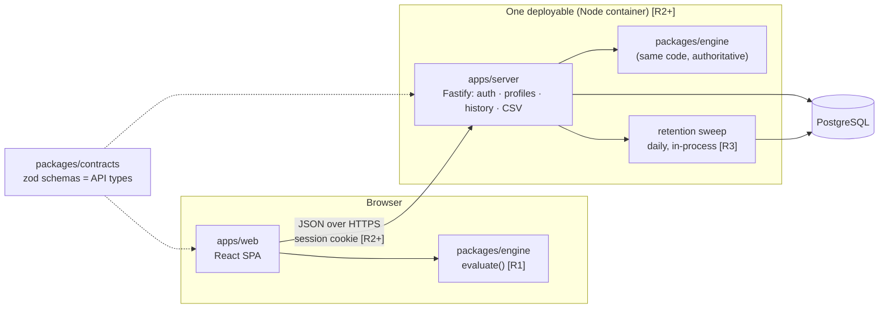
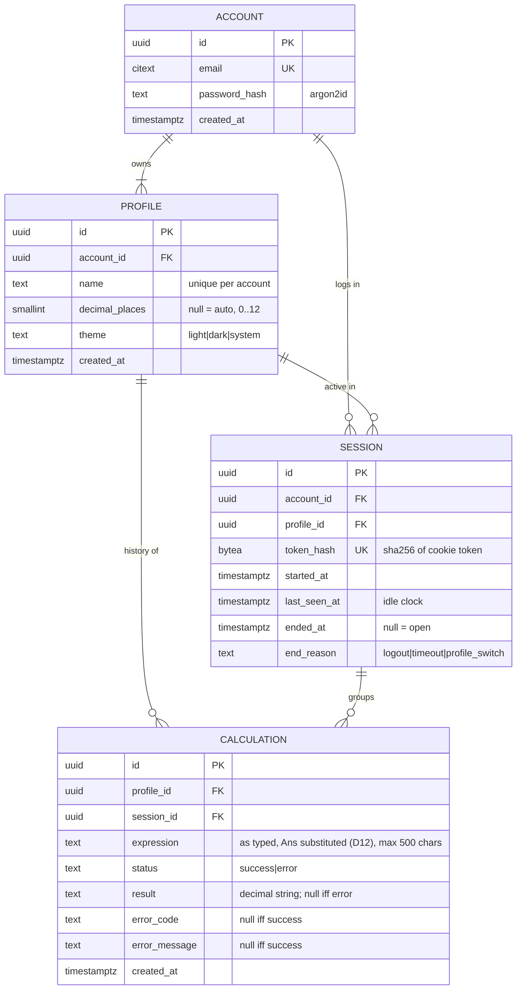
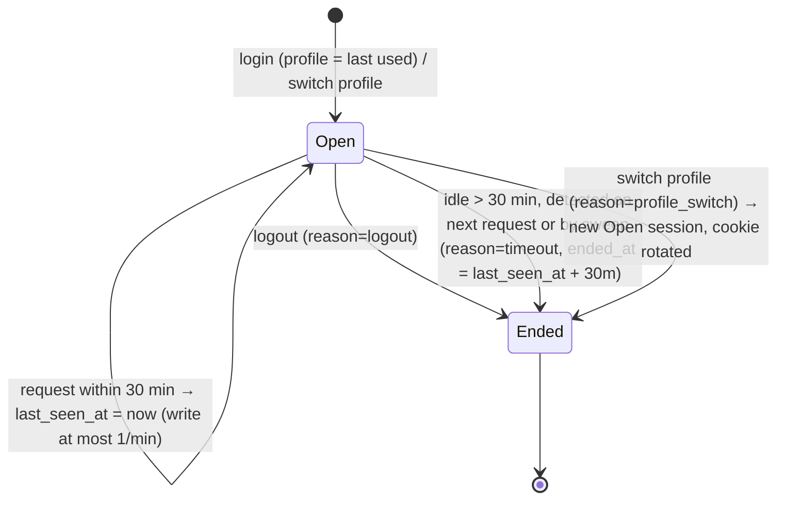

# Calculator Web – Architecture

Status: **Accepted by PO (2026-10-18)** · Owner: Architect · Scope: whole roadmap (R1–R4), R1 (#1, #2) first.
UX specs (Designer, on the shared computer and not yet in the repo): `product/design/R1-1-basic-arithmetic.md` (#1) · `product/design/R1-2-clear-backspace-ans.md` (#2). They own behaviour and copy (decisions D1–D12, approved by PO); this doc only gives them a shape.
Decisions: [ADR 0001 stack](adr/0001-stack-and-repo-layout.md) · [0002 evaluation](adr/0002-expression-evaluation.md) · [0003 auth/sessions](adr/0003-auth-and-profile-sessions.md) · [0004 history/retention](adr/0004-history-storage-and-retention.md)

Legend: **[R1]** build now · **[R2]** accounts/profiles · **[R3]** sessions/history · **[R4]** polish

## 1. System shape



- **R1 is client-only**: `engine` + `web`, deployed as static files. No server, no DB.
- **R2+** adds one Node service that serves the API *and* the built SPA (same origin → no CORS), plus Postgres.
- One engine, two call sites: browser for instant display, server for the stored (authoritative) result. Shipped in one image, so versions cannot drift.

## 2. Stack

| Concern | Choice | Why (one line) |
|---|---|---|
| Language | TypeScript (strict) everywhere | One type system across engine, UI, API, DB. |
| Repo | pnpm workspaces monorepo | Engine/contracts shared without publishing. |
| UI | React + Vite | Boring, fast, huge a11y ecosystem (R4 #11). |
| Numbers | `decimal.js` (precision 34) | Decimal, not binary float: `0.1+0.2 = 0.3`; ≥12 sig. digits (#1). |
| API | Fastify | Small, fast, schema-first, pino logging built in. |
| Validation | zod in `packages/contracts` | Parse at every boundary; TS types derived from schemas. |
| DB | PostgreSQL 16 + Drizzle ORM/migrations | Relational fits; DB types derived from schema; `interval '1 month'`. |
| Passwords | argon2id | OWASP-recommended. |
| Tests | Vitest (unit) · Playwright (e2e, 4 browsers) · axe (a11y) | Matches DoD. |
| CI | GitHub Actions: typecheck, lint, test, e2e | Scaffold first. |

## 3. Repo layout

```
apps/web/            React SPA                         [R1]
packages/engine/     tokenizer+parser+evaluator+format [R1]  (exports: evaluate, format, types ONLY)
apps/server/         Fastify API + static SPA          [R2]
packages/contracts/  zod request/response schemas      [R2]
docs/                ARCHITECTURE.md, adr/
```
Internals are blocked via package.json `"exports"`; importing `engine/src/parser` from outside fails the build.

## 4. Data model [R2+]



Invariants (enforced in DB, mirrored in types):
- `CHECK ((status='success' AND result IS NOT NULL AND error_code IS NULL) OR (status='error' AND result IS NULL AND error_code IS NOT NULL AND error_message IS NOT NULL))`.
- `calculation.session.profile_id = calculation.profile_id` (composite FK `(session_id, profile_id) → session(id, profile_id)`), so an entry can never land in a non-active profile (#6).
- Every account has ≥1 profile: signup creates `Default`; deleting the last profile is rejected.
- Indexes: `calculation(profile_id, created_at DESC)`, `session(token_hash)`, `session(last_seen_at) WHERE ended_at IS NULL`.
- ON DELETE CASCADE: account → profiles → sessions/calculations.

### Session lifecycle (one session = one login on one profile) [R2, grouping used in R3]


Timeout ⇒ 401 ⇒ user logs in again (accounts required, no guest).

### Retention (#8) [R3]
- Single constant `RETENTION = interval '1 month'` in one SQL module.
- **Read path** always filters `created_at >= now() - RETENTION` (correct even if the job is late).
- **Sweep** daily + on boot, guarded by `pg_try_advisory_lock` (idempotent, safe with N replicas): delete calculations older than RETENTION, then sessions whose `coalesce(ended_at, last_seen_at)` is older than RETENTION; close stale open sessions. Logs counts.

### CSV export (#10) [R4]
`GET /api/calculations.csv?q=…` reuses the **same** list query as the history UI (so filter semantics are identical), streams rows, RFC 4180 quoting, columns `expression,result,status,error_message,created_at,session_id`, and, in the free-text columns only (`expression`, `error_message`; `result` is a typed `DecimalString` and stays untouched), prefixes cells starting with `= + - @ \t \r` with `'` (standard CSV-injection guard, `-` included: `-5+3` exports as `'-5+3`; PO decision).

## 5. Core types

```ts
// ---- shared brands ----
type Brand<T, B extends string> = T & { readonly __brand: B };
export type DecimalString = Brand<string, "DecimalString">;   // canonical decimal, e.g. "-12.5"
export type AccountId = Brand<string, "AccountId">;
export type ProfileId = Brand<string, "ProfileId">;
export type SessionId = Brand<string, "SessionId">;
export type CalculationId = Brand<string, "CalculationId">;
export type Email = Brand<string, "Email">;                   // lower-cased, validated once

// ---- packages/engine [R1] — the only public surface ----
export type CalcErrorCode =
  | "syntax"          // unbalanced parens, bad number
  | "incomplete_expression" // input ends where an operand is expected, e.g. "3 +" → "Finish the expression" (D3)
  | "divide_by_zero"  // #1
  | "overflow"        // |x| beyond range
  | "domain"          // R4: log(-1), sqrt(-1)
  | "too_long";       // > 500 chars
export type CalcError = { code: CalcErrorCode; message: string; position?: number };
export type Evaluation =
  | { status: "success"; value: DecimalString }
  | { status: "error"; error: CalcError };

export function evaluate(expression: string, ctx: { ans: DecimalString | null }): Evaluation; // total: never throws; `Ans` resolves to ctx.ans
export function format(v: DecimalString, o?: { decimalPlaces?: number }): string; // ≤12 sig. digits; scientific at ≥1e12 or <1e-6 (D2)

// ---- apps/web editor [R1]: token-based, one pure reducer; buttons & keyboard dispatch the same actions ----
// Behaviour is the Designer spec (R1-1 §1.3/§5, R1-2 §1); this is only its shape.
export type Token =
  | { kind: "digit"; d: "0"|"1"|"2"|"3"|"4"|"5"|"6"|"7"|"8"|"9" }
  | { kind: "point" }
  | { kind: "op"; op: "+" | "−" | "×" | "÷" }
  | { kind: "neg" }                         // unary minus, distinct from op "−"
  | { kind: "percent" }
  | { kind: "paren"; side: "(" | ")" }
  | { kind: "ans" };                        // ONE token; resolves to `ans` at evaluation
export type EditorState =
  | { mode: "empty" }                                         // shows 0
  | { mode: "typing" | "hint"; tokens: readonly Token[] }     // hint = "Finish the expression"
  | { mode: "result"; tokens: readonly Token[]; value: DecimalString }
  | { mode: "error"; tokens: readonly Token[]; error: CalcError };
export type Editor = { state: EditorState; ans: DecimalString | null }; // Ans never holds an error; page memory in R1, per active profile from R2 (D11)
export type EditorAction =
  | { type: "input"; token: Token }  // guarded: invalid keys are no-ops; implicit × inserted as a real token
  | { type: "backspace" }            // pops the last token (whole Ans); in result/error: undo the "="
  | { type: "clear" }                // C: empty display; AC (already empty): also ans = null
  | { type: "evaluate" };            // "=" / Enter: auto-close ")", evaluate(); incomplete_expression → hint mode; repeated "=" is a no-op (D4)
export function reduce(e: Editor, a: EditorAction): Editor;
export function toExpression(tokens: readonly Token[], o?: { substituteAns: DecimalString }): string;
// the ONE serializer: display/eval form "Ans × −2"; save form (R3, D12) substitutes the value: "15 × −2" (negative values wrapped in parentheses)
// KEYS: one table {id,label,token|action,keyboard[]} renders the keypad AND builds the keydown map.

// ---- domain [R2+] ----
export type ProfileSettings = { decimalPlaces: number | null; theme: "light" | "dark" | "system" };
export type Profile = { id: ProfileId; accountId: AccountId; name: string; settings: ProfileSettings; createdAt: Date };
export type SessionEnd = { at: Date; reason: "logout" | "timeout" | "profile_switch" };
export type Session = {
  id: SessionId; accountId: AccountId; profileId: ProfileId;
  startedAt: Date; lastSeenAt: Date; end: SessionEnd | null;
};
export type Calculation = {
  id: CalculationId; profileId: ProfileId; sessionId: SessionId;
  expression: string; createdAt: Date; // expression has Ans substituted (D12)
} & (
  | { status: "success"; result: DecimalString }
  | { status: "error"; error: CalcError }
);

// AuthZ token: constructible ONLY by the session middleware (module-private constructor).
// Every history/profile repository function takes it; no endpoint accepts a profileId for history.
export type ProfileScope = Brand<{ accountId: AccountId; profileId: ProfileId; sessionId: SessionId }, "ProfileScope">;
```

DB rows → domain via one `parseCalculationRow()` per table (reject rows that violate the union). API payloads → domain via `contracts` zod schemas.

## 6. API surface (all JSON, all under `/api`, all scoped by session cookie)

| Release | Method & path | Notes |
|---|---|---|
| R2 | `POST /auth/signup` `{email,password}` | 409 on duplicate email; creates account + `Default` profile + session |
| R2 | `POST /auth/login` · `POST /auth/logout` | login rate-limited; logout ends session |
| R2 | `GET /me` | account, profiles, active profile |
| R2 | `POST /profiles` · `PATCH /profiles/:id` · `DELETE /profiles/:id` | scoped by AccountScope; 404 if not yours |
| R2 | `POST /profiles/:id/activate` | ends session (`profile_switch`), opens new one, rotates cookie |
| R3 | `POST /calculations` `{expression}` → `Calculation` | expression with Ans already substituted (D12; payload containing `Ans` → 400); server re-evaluates with `engine`, client result never trusted; sent on every `=` that is a calculation attempt, incl. incomplete ones (D3), never for no-ops/input feedback |
| R3 | `GET /calculations?q=&before=&limit=` | newest first, keyset pagination, active profile only |
| R3 | `DELETE /calculations/:id` · `DELETE /calculations` | single / clear all (active profile) |
| R4 | `GET /calculations.csv?q=` | same query as list; streamed |

## 7. Non-functional requirements

- **Security**: argon2id (m=19 MiB, t=2, p=1); cookie `__Host-sid` = 256-bit random, `HttpOnly; Secure; SameSite=Lax; Path=/`, only its SHA-256 stored; CSRF: SameSite + require `Content-Type: application/json` + `Origin` check on mutations; profile/account isolation via `ProfileScope` + cross-profile/cross-account tests (DoD); login rate limit; no secrets in repo (env, parsed by zod at boot); generic login errors.
- **Evaluator safety**: no `eval`, no `new Function`, no third-party "math eval" libs. Hand-written tokenizer + recursive-descent parser over a closed grammar; max 500 chars and max nesting depth 100. Same code runs server-side, so this is a hard security requirement, not style.
- **Accuracy**: decimal arithmetic at 34 digits, displayed rounded to 12 significant digits (or profile `decimalPlaces`). Golden test table in `engine`.
- **Performance**: evaluate < 1 ms client-side; API p95 < 200 ms; history queries hit `(profile_id, created_at)` index; 1-month retention bounds table size.
- **Observability**: pino JSON logs with request id; never log passwords, tokens or expressions; `/healthz` (process) and `/readyz` (DB); retention job logs deleted counts; error counts per route.
- **Accessibility**: keypad = real `<button>`s from the KEYS table; result in one polite `role="status"` region. Bar: WCAG 2.2 AA (D7).

## 8. R1 build order (#1, #2)
1. Scaffold: pnpm workspace, strict TS, ESLint, Vitest, Playwright, CI.
2. `packages/engine`: grammar below, golden tests (precision, `÷0`, parens, `%`).
3. `apps/web`: token `reduce()` + `toExpression()` + KEYS table + keypad + keyboard handler; spec scenario tables (R1-1 §4–5, R1-2) become reducer unit tests; e2e in 4 browsers.

R1 grammar (precedence low→high): `expr := term (("+"|"-") term)*` · `term := unary (("*"|"/"|"×"|"÷") unary)*` · `unary := ("-"|"+") unary | postfix` · `postfix := primary "%"?` (`x% = x ÷ 100`, so `200 + 10% = 200.1`; D1, PO-confirmed) · `primary := number | "Ans" | "(" expr ")"`. `−` and `×`/`÷` glyphs normalized in the tokenizer. Implicit × and auto-closed `)` are produced by the editor as real tokens, so the grammar stays free of them. Nothing in R1 blocks R2–R4: functions (R4) add one `primary` alternative.

## 9. Decisions recorded (PO, 2026-10-18)
1. `%` = postfix ÷ 100 (`200 + 10% = 200.1`).
2. Login opens the last-used profile, i.e. the profile of the account's most recent session. If there is none (new account, or older than retention), the oldest profile is used.
3. 30 min idle ends the session; a fresh login is required.
4. CSV keeps the standard formula guard, including `-`.
5. No `ans` column. Saved expressions have Ans substituted with its value (Designer D12).
6. Designer D2–D12 are accepted. D3 as changed by the PO: `=` on an incomplete expression shows the hint and, **from R3**, is saved as an error entry (`incomplete_expression`, message "Finish the expression", expression as typed).

No open questions.
