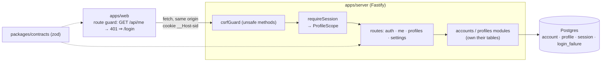
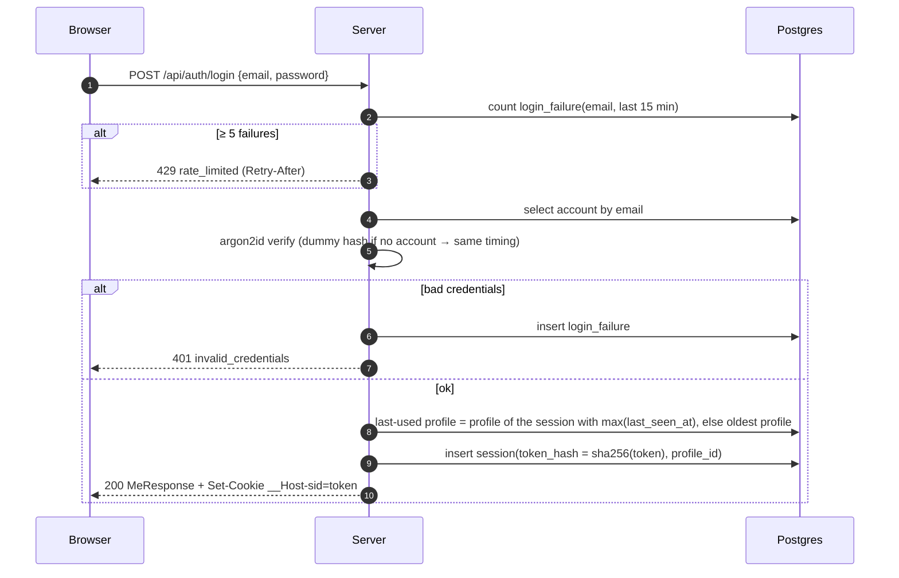
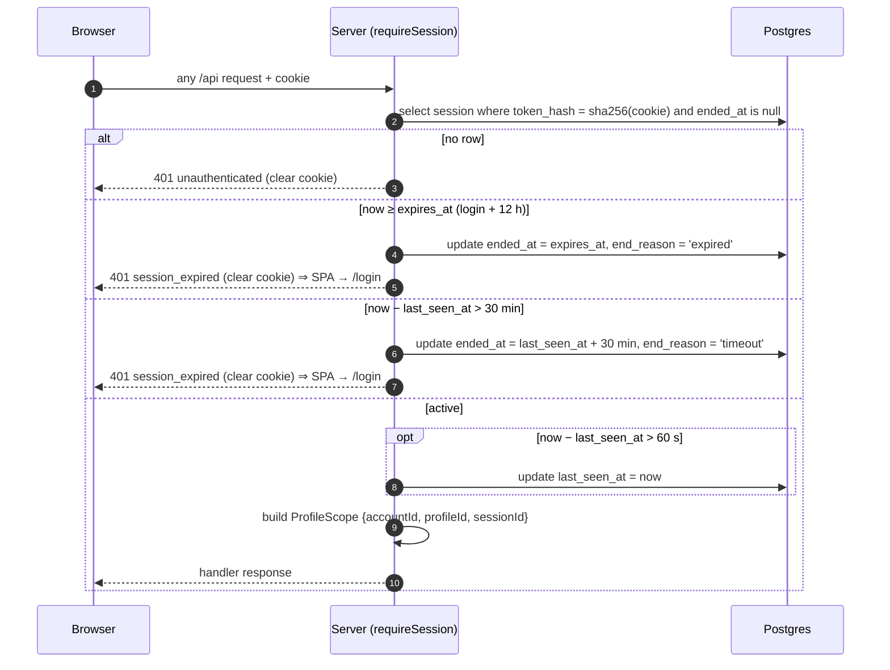
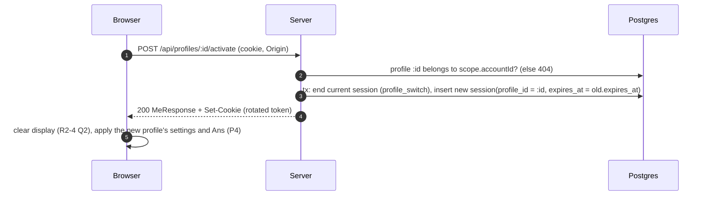

# R2 – Accounts and profiles: architecture detail (#3, #4)

Status: **Accepted by PO (2026-10-18)**, aligned with the approved R2 UX specs (PR #19) and [ADR 0007](../adr/0007-delete-active-profile.md) · Owner: Architect · Builds on [ARCHITECTURE.md](../ARCHITECTURE.md), [ADR 0003](../adr/0003-auth-and-profile-sessions.md) (sessions), [0005](../adr/0005-credential-policy-and-login-throttling.md) (passwords, throttling), [0006](../adr/0006-profile-limits-and-deletion.md) (profile limits and deletion), [0007](../adr/0007-delete-active-profile.md) (deleting the active profile).
UX: `docs/design/R2/R2-3-auth.md` and `R2-4-profiles.md` (approved). Ans is stored **per profile on the server**. It isn't cleared on switch and survives logins; only AC or deleting the profile clears it (P4, R2-4 Q3).

## 1. Shape



New in R2: `packages/contracts` (`@calc/contracts`) and `apps/server` (`@calc/server`: Fastify, Drizzle, `@node-rs/argon2`, `@fastify/cookie`). The server also serves the built SPA for every non-`/api` path, so the SPA does the redirect to log in. Only the `profiles` module writes `profile`, and only the `auth` module writes `account`, `session` and `login_failure`, per split-ownership.

## 2. Flows

### Sign-up and log-in

Sign-up is the same tail: insert the account and a `Default` profile in one transaction, open a session, and return **201** with `MeResponse`. A duplicate email returns **409 email_taken** (#3 requires a clear error, which accepts that sign-up reveals whether an email is registered).

### Every authenticated request, including idle expiry

The idle clock only advances on API calls. To keep a calculating user logged in, the SPA sends `POST /api/session/touch` after real input (§4, Keep-alive). Without real input nothing is sent, so an idle tab expires after 30 min, and every session ends 12 h after login regardless. The 12 h cap is an **essential security limit** under the WCAG 2.2.1 Timing Adjustable exception (PO, R2-3 Q2), so it can't be extended. The client shows the non-modal notice (R2-3 §2.5b) at `session.expiresAt − 10 min`, and the idle warning (DS9) at `session.idleExpiresAt − 2 min`.

### Profile switch


### Delete the active profile (ADR 0007)
```mermaid
sequenceDiagram
  autonumber
  participant B as Browser
  participant S as Server
  participant D as Postgres
  B->>S: DELETE /api/profiles/:id (cookie, Origin), where :id is the active profile
  S->>D: tx: lock account row; :id belongs to account? (else 404); other profiles exist? (else 409 last_profile)
  S->>D: target = remaining profile with max(session.last_seen_at), else oldest remaining
  S->>D: insert session(profile_id = target, expires_at = current.expires_at)
  S->>D: delete profile :id (cascades its sessions incl. the current one, and from R3 its history)
  S-->>B: 200 MeResponse (active = target) + Set-Cookie (new token)
  B->>B: apply target's settings and Ans, announce "Deleted X. Switched to Y."
```
Deleting a non-active profile returns the same `MeResponse` and doesn't rotate the cookie.
Activating the already active profile is a no-op that returns 200 and does not rotate the cookie.

**Create = create + switch (PO, R2-4 Q1):** `POST /api/profiles` runs the same tail in one transaction. It locks the account row, checks the limit, inserts the profile, ends the current session (`profile_switch`), and inserts a new session for the new profile with the **original `expires_at`**. It returns 201 `MeResponse` and sets the new cookie.

## 3. Migrations (Drizzle, `apps/server/drizzle/`, applied in order at deploy)

| # | File | DDL (summary) |
|---|---|---|
| 0000 | `extensions` | `CREATE EXTENSION IF NOT EXISTS citext;` (`gen_random_uuid()` is core in PG 13+) |
| 0001 | `account` | `id uuid PK DEFAULT gen_random_uuid()`, `email citext NOT NULL UNIQUE CHECK (char_length(email) <= 254)`, `password_hash text NOT NULL`, `created_at timestamptz NOT NULL DEFAULT now()` |
| 0002 | `profile` | `id uuid PK`, `account_id uuid NOT NULL REFERENCES account ON DELETE CASCADE`, `name text NOT NULL CHECK (name = btrim(name) AND char_length(name) BETWEEN 1 AND 40)`, `decimal_places smallint NULL CHECK (decimal_places BETWEEN 0 AND 12)` (NULL = auto, D2), `theme text NOT NULL DEFAULT 'system' CHECK (theme IN ('light','dark','system'))` (DS7), `ans text NULL CHECK (char_length(ans) <= 48)` (engine canonical `DecimalString`, 34 significant digits, ADR 0008; NULL = no Ans; format validated by `contracts`; folded into 0002 because no R2 migration has been generated or applied yet), `created_at timestamptz NOT NULL DEFAULT now()`; `UNIQUE (id, account_id)` (FK target); `UNIQUE INDEX profile_name_uq ON profile (account_id, lower(name))`; `INDEX ON profile (account_id, created_at)` |
| 0003 | `session` | `id uuid PK`, `account_id uuid NOT NULL`, `profile_id uuid NOT NULL`, `FOREIGN KEY (profile_id, account_id) REFERENCES profile (id, account_id) ON DELETE CASCADE` (the profile must belong to the account), `account_id REFERENCES account ON DELETE CASCADE`, `token_hash bytea NOT NULL UNIQUE CHECK (octet_length(token_hash) = 32)`, `started_at`/`last_seen_at timestamptz NOT NULL DEFAULT now()`, `expires_at timestamptz NOT NULL` (login: `now() + interval '12 hours'`; copied on profile switch), `CHECK (expires_at > started_at)`, `ended_at timestamptz NULL`, `end_reason text NULL CHECK (end_reason IN ('logout','timeout','expired','profile_switch'))`, `CHECK ((ended_at IS NULL) = (end_reason IS NULL))`; `UNIQUE (id, profile_id)` (FK target for R3 `calculation`); `INDEX ON session (account_id, last_seen_at DESC)` (last-used / most recently used profile); `INDEX ON session (last_seen_at) WHERE ended_at IS NULL` and `INDEX ON session (expires_at) WHERE ended_at IS NULL` (sweep) |
| 0004 | `login_failure` | `id bigint GENERATED ALWAYS AS IDENTITY PK`, `email citext NOT NULL`, `ip inet NULL`, `at timestamptz NOT NULL DEFAULT now()`; `INDEX ON login_failure (email, at DESC)`. Rows older than 1 day are removed by the daily sweep (ADR 0004 job) |

R3 adds `0005_calculation` as specified in ARCHITECTURE.md §4. Domain types come from the Drizzle schema plus one `parse…Row()` per table (ADR 0001).

## 4. API contract (`packages/contracts`, zod 4)

```ts
// primitives (validated once, branded)
export const Email = z.string().trim().toLowerCase().pipe(z.email().max(254)).brand<"Email">();
export const NewPassword = z.string().min(12).max(128);          // ADR 0005; login accepts any 1..128
export const ProfileName = z.string().trim().min(1).max(40);
export const Theme = z.enum(["light", "dark", "system"]);
export const ProfileSettings = z.object({
  decimalPlaces: z.number().int().min(0).max(12).nullable(),     // null = auto (12 sig. digits, D2)
  theme: Theme,
});
// requests
export const SignupRequest = z.object({ email: Email, password: NewPassword });
export const LoginRequest  = z.object({ email: Email, password: z.string().min(1).max(128) });
export const ProfileNameRequest = z.object({ name: ProfileName });          // create and rename
export const SettingsPatch = ProfileSettings.partial()
  .refine(o => Object.keys(o).length > 0, "empty patch");
// responses
export const DecimalStringSchema = z.string().max(48)
  .regex(/^-?\d(\.\d{1,33})?e[+-]\d{1,4}$/).brand<"DecimalString">(); // engine canonical form (ADR 0008)
export const AnsRequest = z.object({ ans: DecimalStringSchema.nullable() });               // null = AC
export const ProfileDto = z.object({ id: z.uuid(), name: z.string(), settings: ProfileSettings,
  ans: DecimalStringSchema.nullable(), createdAt: z.iso.datetime() });
export const SessionInfo = z.object({
  expiresAt: z.iso.datetime(),       // absolute cap (login + 12 h): 10-min notice
  idleExpiresAt: z.iso.datetime(),   // last_seen_at + 30 min: 2-min idle warning (DS9)
});
export const MeResponse = z.object({
  account: z.object({ id: z.uuid(), email: z.string() }),
  activeProfileId: z.uuid(),
  profiles: z.array(ProfileDto),                                 // oldest first
  session: SessionInfo,
});
export const ErrorCode = z.enum([
  "validation_failed", "unauthenticated", "session_expired", "invalid_credentials",
  "csrf_rejected", "not_found", "email_taken", "password_too_common", "profile_name_taken",
  "profile_limit", "last_profile", "rate_limited", "internal",
]);
export const ErrorResponse = z.object({
  error: z.object({ code: ErrorCode, message: z.string(), fields: z.record(z.string(), z.string()).optional() }),
});
```

| Method & path | Body → response | Success | Errors |
|---|---|---|---|
| `POST /api/auth/signup` | `SignupRequest` → `MeResponse` + cookie | 201 | 400 validation_failed / password_too_common (ADR 0005) · 409 email_taken · 429 |
| `POST /api/auth/login` | `LoginRequest` → `MeResponse` + cookie | 200 | 400 · 401 invalid_credentials · 429 rate_limited |
| `POST /api/auth/logout` | – → – (ends session, clears cookie; idempotent) | 204 | – |
| `GET /api/me` | – → `MeResponse` | 200 | 401 unauthenticated / session_expired |
| `POST /api/session/touch` | – (no body) → `SessionInfo` (sets `last_seen_at`, never `expires_at`) | 200 | 401 session_expired / unauthenticated |
| `PATCH /api/profile/ans` | `AnsRequest` → `SessionInfo` (**active profile only**; also counts as activity) | 200 | 400 |
| `POST /api/profiles` | `ProfileNameRequest` → `MeResponse` + rotated cookie. Creates the profile and switches to it atomically (R2-4 Q1) | 201 | 400 · 409 profile_name_taken / profile_limit |
| `PATCH /api/profiles/:id` | `ProfileNameRequest` → `ProfileDto` (rename any own profile) | 200 | 400 · 404 · 409 profile_name_taken |
| `DELETE /api/profiles/:id` | – → `MeResponse`. If `:id` is active: switch to the most recently used remaining profile and set a rotated cookie (ADR 0007) | 200 | 404 · 409 last_profile |
| `POST /api/profiles/:id/activate` | – → `MeResponse` + rotated cookie | 200 | 404 |
| `PATCH /api/profile/settings` | `SettingsPatch` → `ProfileDto` (**active profile only**, #4) | 200 | 400 |

Rules for every row:
- All except signup and login require a session, so they can also return 401.
- Another account's profile id returns **404**, never 403.
- Unknown body keys return 400 (`z.strictObject` at the route).
- Responses are parsed by the same schemas in tests.

**Keep-alive (PO decision):**
- **Server:** `POST /api/session/touch` and `PATCH /api/profile/ans` are the *activity* endpoints. Both go through the CSRF guard, write `last_seen_at` unthrottled, and return `SessionInfo`.
- **Client:** one module, `sessionKeepAlive`, listens for `keydown` and `pointerdown` with `event.isTrusted` on the app root. On such an event, if no activity call succeeded in the last 60 s, it sends a touch. The latest `SessionInfo` drives both notices and is shared across tabs via `BroadcastChannel('session')` (DS8: activity in one tab closes the warning everywhere). "Stay logged in" is a touch.
- **No network timers:** there are no intervals or background pings, and visibility or focus events don't count. The UI timers only show the notices. Without real input the session idles out as usual.
- **401:** a 401 from any call sends the user to log in.

**Ans sync (P4):**
- **R2:** after each successful `=`, and on AC (`ans: null`), the client sends `PATCH /api/profile/ans`. The call counts as activity, so it doubles as the touch and resets the 60 s throttle. `=` that ends in an error or an incomplete expression sends nothing, because Ans never holds an error.
- **Loading:** Ans arrives with the profile in `MeResponse`, on login, switch, delete and focus re-read.
- **R3:** `POST /calculations` sets `profile.ans` to the result in the same transaction on success, so the client then only sends the AC `null`. History keeps storing the *substituted* expression (D12), so the saved expression never depends on `profile.ans`.
- **Profile deletion** removes its Ans with the row.

**Unsaved input after re-login (R2-3 Q3):**
- On a 401 `session_expired`, the SPA writes the in-progress editor tokens to `sessionStorage['calc:draft:'+accountId]` (this tab only). It is never sent to the server.
- After a login to the **same** account in that tab it restores and deletes the draft. A login to a different account deletes every `calc:draft:*` key. Closing the tab drops it.

**Cookie:** `__Host-sid=<32 random bytes, base64url>; HttpOnly; Secure; SameSite=Lax; Path=/`. There is no `Max-Age`, so the browser drops it at close. The server's idle and 12 h rules decide validity. Only `sha256(token)` is stored. Local dev runs on `http://localhost`, which browsers treat as secure, so it works unchanged.

**CSRF (unchanged strategy, ARCHITECTURE §7):** on `POST/PATCH/PUT/DELETE`:
1. `Origin` must equal `APP_ORIGIN`. If `Origin` is missing, `Sec-Fetch-Site` must be `same-origin`. Otherwise **403 csrf_rejected**.
2. A request with a body must be `Content-Type: application/json`. That rules out cross-site simple-form posts.

Together with `SameSite=Lax`, there are no CSRF tokens to manage. Login and signup are covered too (login-CSRF).

**Concurrency:**
- Profile create and delete take `SELECT … FROM account WHERE id = $1 FOR UPDATE` inside the transaction, so the limit and last-profile checks can't race.
- Name uniqueness comes from the unique index, and a violation maps to 409.
- Switching profile ends the old session, so an in-flight request that still carries the old cookie gets 401. The SPA's API client retries `GET /api/me` once after any 401 before redirecting.

## 5. Core types added (server)

```ts
type AccountScope = Brand<{ accountId: AccountId; sessionId: SessionId }, "AccountScope">;  // profile CRUD
// ProfileScope (ARCHITECTURE §5) extends it with profileId: settings, and history from R3.
// Both are constructible only inside requireSession.
interface Profiles {
  list(s: AccountScope): Promise<Profile[]>;
  create(s: ProfileScope, name: ProfileName): Promise<{ me: Me; token: SessionToken }>; // limit 10 (ADR 0006); new profile becomes active
  rename(s: AccountScope, id: ProfileId, name: ProfileName): Promise<Profile>;
  remove(s: ProfileScope, id: ProfileId): Promise<{ me: Me; token?: SessionToken }>; // not last; active → switch (ADR 0007)
  setAns(s: ProfileScope, ans: DecimalString | null): Promise<SessionInfo>;
  updateSettings(s: ProfileScope, patch: Partial<ProfileSettings>): Promise<Profile>;
}
interface Auth {
  signup(email: Email, password: string): Promise<{ me: Me; token: SessionToken }>;
  login(email: Email, password: string, ip: string): Promise<{ me: Me; token: SessionToken }>;
  logout(token: SessionToken): Promise<void>;
  activate(s: ProfileScope, id: ProfileId): Promise<{ me: Me; token: SessionToken }>;
  touch(s: ProfileScope): Promise<SessionInfo>;                   // last_seen_at = now; expires_at unchanged
  resolve(token: SessionToken): Promise<ProfileScope | "unauthenticated" | "session_expired">;
}
```

## 6. Out of scope for R2 (accepted limitations)
No password reset and no email verification (**accepted by PO**; a Password reset story is on the Later horizon). Changing email or password and deleting an account aren't in #3/#4 either. The schema doesn't block any of them.

## 7. Decisions recorded (PO, 2026-10-18)
1. Minimum password length is 12, plus an offline common-password check (`password_too_common`). HIBP k-anonymity is a later option (ADR 0005).
2. No password reset or email verification in R2. Accepted limitation; Password reset is a Later story.
3. Keep-alive: **closed**, resolved by `POST /api/session/touch`, sent after real input at most once a minute (§4).
4. 12 h absolute session lifetime via `expires_at`, end reason `expired` (§2, §3, ADR 0003 amendment).
5. Maximum 10 profiles per account (ADR 0006).
6. Deleting the active profile is allowed and switches to the most recently used remaining profile. The last profile still can't be deleted (ADR 0007).
7. The default theme is `system` (DS7).
8. Ans is stored per profile on the server (`profile.ans`). It isn't cleared on switch and persists across logins; it is cleared only by AC or by deleting the profile (P4).
9. The 12 h cap is an essential security limit (WCAG 2.2.1 exception), with a notice 10 minutes before `expiresAt`. Unsaved input is restored after re-login to the same account in the same tab.
10. A newly created profile becomes active: create and switch happen atomically, keeping `expires_at` (R2-4 Q1).
11. No number-format setting in R2; it's Later story #23, so there's no column (R2-4 Q5).
12. Ans representation and numeric range: ADR 0008. It supersedes the earlier 1024-character `ans` cap.

## 8. Designer items (resolved by the approved R2 specs, PR #19)
Multiple tabs: shared active profile, re-read on focus, logout everywhere (DS8). Delete is confirmed (DS6). The log-in screen explains why the user was logged out (DS9; both idle and 12 h return `session_expired`, and the SPA knows which one from the last `SessionInfo`). First profile "Default" (DS7).
