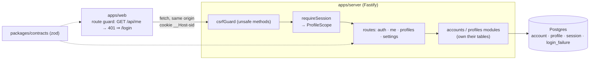
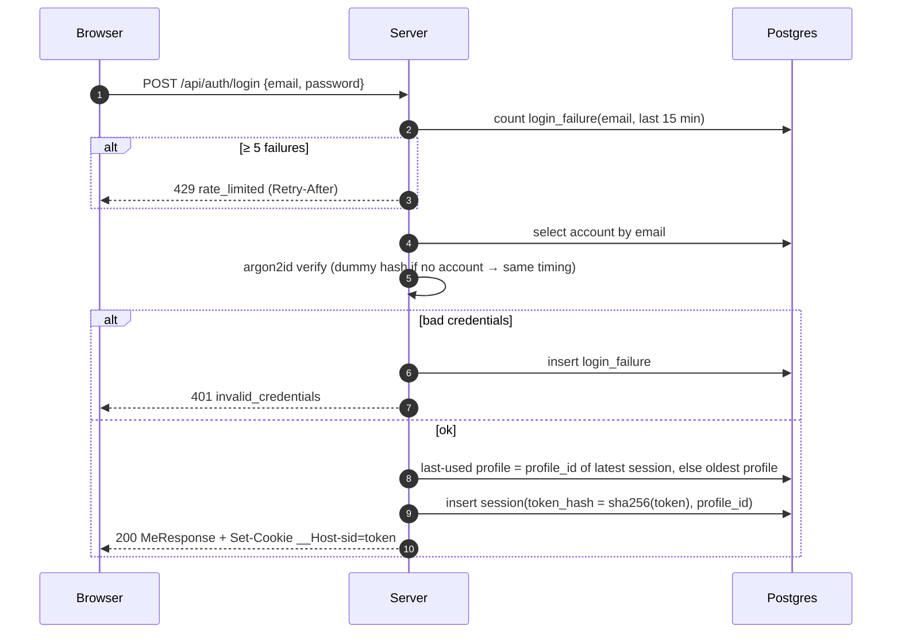
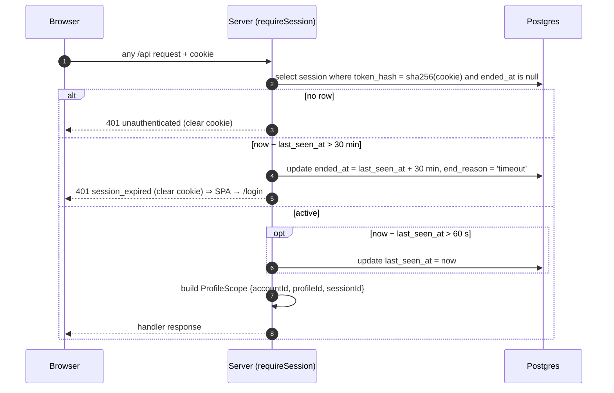
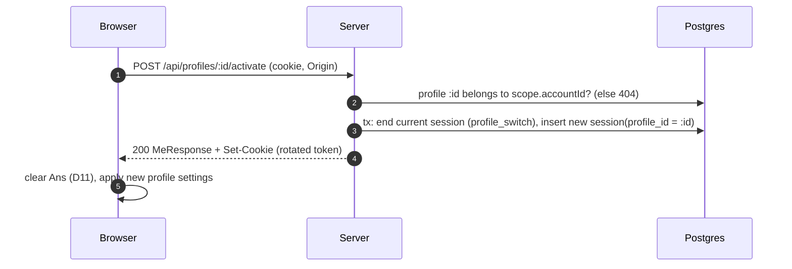

# R2 – Accounts and profiles: architecture detail (#3, #4)

Status: **Proposed (In Review)** · Owner: Architect · Builds on [ARCHITECTURE.md](../ARCHITECTURE.md), [ADR 0003](../adr/0003-auth-and-profile-sessions.md) (sessions), [0005](../adr/0005-credential-policy-and-login-throttling.md) (passwords, throttling), [0006](../adr/0006-profile-limits-and-deletion.md) (profile limits and deletion).
UX: there is **no R2 Designer spec yet** (none in `/workspace/product/design` or `docs/design`). R1 spec slots used: header-right = profile switcher + account menu, and a pre-calculator log-in / sign-up route (R1-1 §2.4). D11: Ans lives per active profile and is cleared on switch.

## 1. Shape



New in R2: `packages/contracts` (`@calc/contracts`) and `apps/server` (`@calc/server`: Fastify, Drizzle, `@node-rs/argon2`, `@fastify/cookie`). The server also serves the built SPA for every non-`/api` path, so the SPA does the redirect to log in. Only the `profiles` module writes `profile`, and only the `auth` module writes `account`, `session` and `login_failure`, per split-ownership.

## 2. Flows

### Sign-up and log-in

Sign-up is the same tail: insert the account and a `Default` profile in one transaction, open a session, and return **201** with `MeResponse`. A duplicate email returns **409 email_taken** (#3 requires a clear error, which accepts that sign-up reveals whether an email is registered).

### Every authenticated request, including idle expiry

The idle clock only advances on API calls. The SPA calls no API while the user just types in R1/R2, so 30 min of local-only work also expires (see open question 3). R3 makes every `=` an API call.

### Profile switch

Activating the already active profile is a no-op that returns 200 and does not rotate the cookie.

## 3. Migrations (Drizzle, `apps/server/drizzle/`, applied in order at deploy)

| # | File | DDL (summary) |
|---|---|---|
| 0000 | `extensions` | `CREATE EXTENSION IF NOT EXISTS citext;` (`gen_random_uuid()` is core in PG 13+) |
| 0001 | `account` | `id uuid PK DEFAULT gen_random_uuid()`, `email citext NOT NULL UNIQUE CHECK (char_length(email) <= 254)`, `password_hash text NOT NULL`, `created_at timestamptz NOT NULL DEFAULT now()` |
| 0002 | `profile` | `id uuid PK`, `account_id uuid NOT NULL REFERENCES account ON DELETE CASCADE`, `name text NOT NULL CHECK (name = btrim(name) AND char_length(name) BETWEEN 1 AND 40)`, `decimal_places smallint NULL CHECK (decimal_places BETWEEN 0 AND 12)` (NULL = auto, D2), `theme text NOT NULL DEFAULT 'light' CHECK (theme IN ('light','dark','system'))`, `created_at timestamptz NOT NULL DEFAULT now()`; `UNIQUE (id, account_id)` (FK target); `UNIQUE INDEX profile_name_uq ON profile (account_id, lower(name))`; `INDEX ON profile (account_id, created_at)` |
| 0003 | `session` | `id uuid PK`, `account_id uuid NOT NULL`, `profile_id uuid NOT NULL`, `FOREIGN KEY (profile_id, account_id) REFERENCES profile (id, account_id) ON DELETE CASCADE` (the profile must belong to the account), `account_id REFERENCES account ON DELETE CASCADE`, `token_hash bytea NOT NULL UNIQUE CHECK (octet_length(token_hash) = 32)`, `started_at`/`last_seen_at timestamptz NOT NULL DEFAULT now()`, `ended_at timestamptz NULL`, `end_reason text NULL CHECK (end_reason IN ('logout','timeout','profile_switch'))`, `CHECK ((ended_at IS NULL) = (end_reason IS NULL))`; `UNIQUE (id, profile_id)` (FK target for R3 `calculation`); `INDEX ON session (account_id, started_at DESC)` (last-used profile); `INDEX ON session (last_seen_at) WHERE ended_at IS NULL` (sweep) |
| 0004 | `login_failure` | `id bigint GENERATED ALWAYS AS IDENTITY PK`, `email citext NOT NULL`, `ip inet NULL`, `at timestamptz NOT NULL DEFAULT now()`; `INDEX ON login_failure (email, at DESC)`. Rows older than 1 day are removed by the daily sweep (ADR 0004 job) |

R3 adds `0005_calculation` as specified in ARCHITECTURE.md §4. Domain types come from the Drizzle schema plus one `parse…Row()` per table (ADR 0001).

## 4. API contract (`packages/contracts`, zod 4)

```ts
// primitives (validated once, branded)
export const Email = z.string().trim().toLowerCase().pipe(z.email().max(254)).brand<"Email">();
export const NewPassword = z.string().min(12).max(128);          // ADR 0005; login accepts any 1..128
export const ProfileName = z.string().trim().min(1).max(40);
export const Theme = z.enum(["light", "dark", "system"]);
export const ProfileSettings = z.object({
  decimalPlaces: z.number().int().min(0).max(12).nullable(),     // null = auto (12 sig. digits, D2)
  theme: Theme,
});
// requests
export const SignupRequest = z.object({ email: Email, password: NewPassword });
export const LoginRequest  = z.object({ email: Email, password: z.string().min(1).max(128) });
export const ProfileNameRequest = z.object({ name: ProfileName });          // create and rename
export const SettingsPatch = ProfileSettings.partial()
  .refine(o => Object.keys(o).length > 0, "empty patch");
// responses
export const ProfileDto = z.object({ id: z.uuid(), name: z.string(), settings: ProfileSettings, createdAt: z.iso.datetime() });
export const MeResponse = z.object({
  account: z.object({ id: z.uuid(), email: z.string() }),
  activeProfileId: z.uuid(),
  profiles: z.array(ProfileDto),                                 // oldest first
});
export const ErrorCode = z.enum([
  "validation_failed", "unauthenticated", "session_expired", "invalid_credentials",
  "csrf_rejected", "not_found", "email_taken", "profile_name_taken",
  "profile_limit", "last_profile", "profile_active", "rate_limited", "internal",
]);
export const ErrorResponse = z.object({
  error: z.object({ code: ErrorCode, message: z.string(), fields: z.record(z.string(), z.string()).optional() }),
});
```

| Method & path | Body → response | Success | Errors |
|---|---|---|---|
| `POST /api/auth/signup` | `SignupRequest` → `MeResponse` + cookie | 201 | 400 validation_failed · 409 email_taken · 429 |
| `POST /api/auth/login` | `LoginRequest` → `MeResponse` + cookie | 200 | 400 · 401 invalid_credentials · 429 rate_limited |
| `POST /api/auth/logout` | – → – (ends session, clears cookie; idempotent) | 204 | – |
| `GET /api/me` | – → `MeResponse` | 200 | 401 unauthenticated / session_expired |
| `POST /api/profiles` | `ProfileNameRequest` → `ProfileDto` | 201 | 400 · 409 profile_name_taken / profile_limit |
| `PATCH /api/profiles/:id` | `ProfileNameRequest` → `ProfileDto` (rename any own profile) | 200 | 400 · 404 · 409 profile_name_taken |
| `DELETE /api/profiles/:id` | – → – | 204 | 404 · 409 last_profile / profile_active |
| `POST /api/profiles/:id/activate` | – → `MeResponse` + rotated cookie | 200 | 404 |
| `PATCH /api/profile/settings` | `SettingsPatch` → `ProfileDto` (**active profile only**, #4) | 200 | 400 |

Rules for every row:
- All except signup and login require a session, so they can also return 401.
- Another account's profile id returns **404**, never 403.
- Unknown body keys return 400 (`z.strictObject` at the route).
- Responses are parsed by the same schemas in tests.

**Cookie:** `__Host-sid=<32 random bytes, base64url>; HttpOnly; Secure; SameSite=Lax; Path=/`. There is no `Max-Age`, so the browser drops it at close, and the server's idle rule decides validity. Only `sha256(token)` is stored. Local dev runs on `http://localhost`, which browsers treat as secure, so it works unchanged.

**CSRF (unchanged strategy, ARCHITECTURE §7):** on `POST/PATCH/PUT/DELETE`:
1. `Origin` must equal `APP_ORIGIN`. If `Origin` is missing, `Sec-Fetch-Site` must be `same-origin`. Otherwise **403 csrf_rejected**.
2. A request with a body must be `Content-Type: application/json`. That rules out cross-site simple-form posts.

Together with `SameSite=Lax`, there are no CSRF tokens to manage. Login and signup are covered too (login-CSRF).

**Concurrency:**
- Profile create and delete take `SELECT … FROM account WHERE id = $1 FOR UPDATE` inside the transaction, so the limit and last-profile checks can't race.
- Name uniqueness comes from the unique index, and a violation maps to 409.
- Switching profile ends the old session, so an in-flight request that still carries the old cookie gets 401. The SPA's API client retries `GET /api/me` once after any 401 before redirecting.

## 5. Core types added (server)

```ts
type AccountScope = Brand<{ accountId: AccountId; sessionId: SessionId }, "AccountScope">;  // profile CRUD
// ProfileScope (ARCHITECTURE §5) extends it with profileId: settings, and history from R3.
// Both are constructible only inside requireSession.
interface Profiles {
  list(s: AccountScope): Promise<Profile[]>;
  create(s: AccountScope, name: ProfileName): Promise<Profile>;              // limit 10, ADR 0006
  rename(s: AccountScope, id: ProfileId, name: ProfileName): Promise<Profile>;
  remove(s: ProfileScope, id: ProfileId): Promise<void>;                     // not active, not last
  updateSettings(s: ProfileScope, patch: Partial<ProfileSettings>): Promise<Profile>;
}
interface Auth {
  signup(email: Email, password: string): Promise<{ me: Me; token: SessionToken }>;
  login(email: Email, password: string, ip: string): Promise<{ me: Me; token: SessionToken }>;
  logout(token: SessionToken): Promise<void>;
  activate(s: ProfileScope, id: ProfileId): Promise<{ me: Me; token: SessionToken }>;
  resolve(token: SessionToken): Promise<ProfileScope | "unauthenticated" | "session_expired">;
}
```

## 6. Out of scope for R2
Email verification, password reset, change of email or password, and account deletion are not in #3/#4. The schema doesn't block them (see open questions).

## 7. Open questions
1. **Password policy (PO):** proposed minimum 12, maximum 128, no composition rules (ADR 0005). NIST SP 800-63B-4 asks for 15 for single-factor passwords. Should it be 12 or 15?
2. **Password reset and email verification (PO):** neither is in R2's acceptance criteria. A user who forgets their password has no recovery path. Accept that for R2, or add a story?
3. **Idle clock (PO):** R1/R2 make no API calls while the user calculates, so 30 min of pure calculating logs the user out. Options: (a) accept it until R3, where every `=` is an API call; (b) the SPA sends a heartbeat when the user does something (proposed: at most once a minute, only after real input).
4. **Absolute session lifetime (PO):** there is currently no maximum session length, so constant activity keeps a session alive indefinitely. Add a cap such as 12 h?
5. **Profile limit (PO):** proposed maximum of 10 profiles per account (ADR 0006).
6. **Deleting the active profile (Designer/PO):** proposed to be rejected (409 `profile_active`), so the user switches first. The alternative is auto-switching to the oldest remaining profile. Deleting a profile immediately and permanently removes its sessions and (from R3) its history. Does the UI confirm this?
7. **First profile name and default theme (Designer):** `Default` is the proposed first profile name and `light` (the R1 look) the proposed default theme. Could `system` be the default instead? The dark theme design is still to come (R1-1 §3.4).
8. **Multiple tabs (Designer):** the active profile belongs to the browser (one cookie), not to a tab. A switch in tab A changes tab B on its next request. Proposed: the SPA re-reads `GET /api/me` on window focus and shows the new profile. Is that OK?
9. **Expiry copy (Designer):** the SPA can tell `session_expired` from `unauthenticated`. Should the log-in screen show "You were logged out after 30 minutes of inactivity"?
10. **R2 UX spec (Designer):** there is no spec yet for the log-in/sign-up screens, the profile switcher, the profile management screens or settings. This doc only fixes the API and data behind them.
