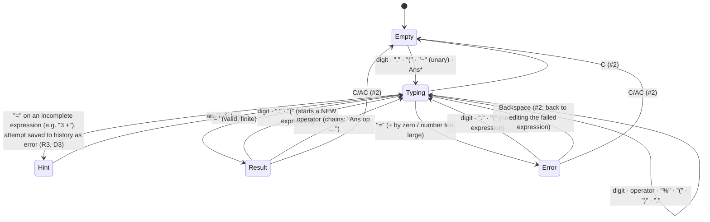
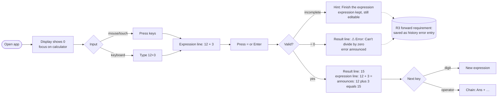
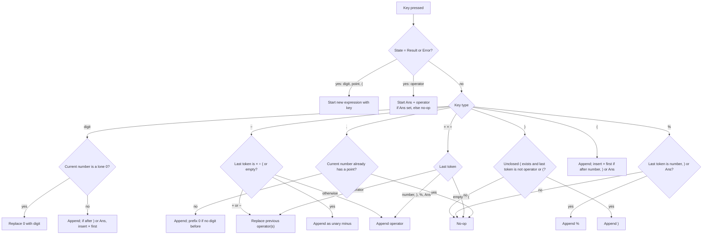

# R1 · #1 Basic arithmetic in the browser — UX/UI spec

| | |
|---|---|
| Issue | [chjort/calculator-web#1](https://github.com/chjort/calculator-web/issues/1) · Milestone R1 – Core calculator |
| Companion spec | [R1-2-clear-backspace-ans.md](R1-2-clear-backspace-ans.md) (#2: C/AC, Backspace, Ans) |
| Owner | Designer (UX) · Design **approved by PO (2026-10-18)**, see §11 Decisions |
| Accessibility target | **WCAG 2.2 AA is the bar** (PO decision D7, 2026-10-18; matches the roadmap and #11) |
| Scope | User flows, wireframes, UI spec, copy and accessibility. **No** framework, state-management or evaluation-engine choices: those belong to engineering. |

This file holds the **shared R1 foundation**: page shell, display, keypad, design tokens, focus and the global keyboard model. #2 builds on it.

---

## 1. User flows

### 1.1 Calculator states


`*` Ans behaviour is specified in #2.

### 1.2 One calculation (happy path, divide by zero, incomplete)



### 1.3 Key-press decision logic (input guard)

The expression can never become malformed; invalid keys are no-ops (no error, nothing announced).



---

## 2. Wireframes

### 2.1 Desktop (≥ 1024 px): R1, with reserved slots for later milestones

```
┌────────────────────────────────────────────────────────────────────────────┐
│ ▣ Calculator                                     [ account slot · R2 ]     │ header 56px
├────────────────────────────────────────────────────────────────────────────┤
│                                                     ┊                      │
│            ┌──────────────────────────────────┐     ┊  history slot · R3   │
│            │ Ans = 15                         │◄─ status row (#2)          │
│            │                    12 × (3 − 1) =│◄─ expression line          │
│            │                               24 │◄─ result line (live)       │
│            ├────────┬────────┬────────┬───────┤     ┊  (side panel 320px,  │
│            │   AC   │   (    │   )    │   ⌫   │     ┊   not rendered in R1)│
│            ├────────┼────────┼────────┼───────┤     ┊                      │
│            │   7    │   8    │   9    │   ÷   │     ┊                      │
│            ├────────┼────────┼────────┼───────┤     ┊                      │
│            │   4    │   5    │   6    │   ×   │     ┊                      │
│            ├────────┼────────┼────────┼───────┤     ┊                      │
│            │   1    │   2    │   3    │   −   │     ┊                      │
│            ├────────┼────────┼────────┼───────┤     ┊                      │
│            │   0    │   .    │   %    │   +   │     ┊                      │
│            ├────────┼────────┴────────┴───────┤     ┊                      │
│            │  Ans   │           =             │     ┊                      │
│            └────────┴─────────────────────────┘     ┊                      │
│              ▸ Keyboard shortcuts                    ┊                      │
└────────────────────────────────────────────────────────────────────────────┘
  calculator card: max-width 400px, centred in the main column
```

### 2.2 Mobile (320–599 px)

```
┌──────────────────────────────┐
│ ▣ Calculator   [acct·R2][☰R3]│ header 56px; R3 opens history as a drawer
├──────────────────────────────┤
│ Ans = 15                     │
│               12 × (3 − 1) = │
│                           24 │
├───────┬───────┬───────┬──────┤
│  AC   │   (   │   )   │  ⌫   │  keys: ≥ 56px tall,
├───────┼───────┼───────┼──────┤  width = (100% − 3 gaps)/4
│   7   │   8   │   9   │  ÷   │  at 320px: ≈ 70 × 56px
├───────┼───────┼───────┼──────┤
│   4   │   5   │   6   │  ×   │
├───────┼───────┼───────┼──────┤
│   1   │   2   │   3   │  −   │
├───────┼───────┼───────┼──────┤
│   0   │   .   │   %   │  +   │
├───────┼───────┴───────┴──────┤
│  Ans  │          =           │
└───────┴──────────────────────┘
 ▸ Keyboard shortcuts
```

### 2.3 Tablet (600–1023 px)
Same as mobile, centred, card max-width 400px. History (R3) opens as an overlay drawer from the header.

### 2.4 Layout slots (reserved, not built in R1)

| Slot | R1 | Later |
|---|---|---|
| Header right | empty (render nothing, no placeholder) | R2: profile switcher + account menu (log out) |
| Header right, < 1024px | empty | R3: "History" button that opens a drawer |
| Side panel, ≥ 1024px | not rendered; the card stays centred | R3: history panel, 320px, on the right. The card moves left and stays ≥ 320px wide |
| Keypad left column group | not rendered | R4 (#9): scientific keys as an extra key group / toggle |
| Pre-calculator route | none | R2: log-in / sign-up screen (account required, Decision 1) |

---

## 3. Layout & component spec

### 3.1 Page shell
- `header` (landmark `banner`): app name "Calculator" (text, 20px/600), height 56px, padding 0 16px.
- `main` (landmark `main`): the calculator card is the only content. Page `<title>`: "Calculator".
- `h1` is visually hidden: "Calculator".
- Card: background `surface`, radius 16px, padding 16px (mobile 12px), gap 12px between display and keypad. Card width: 100% up to 400px max.

### 3.2 Display (`role="group"`, `aria-label="Calculator display"`, `tabindex="0"`, receives focus on load)

```
┌──────────────────────────────────────┐
│ Ans = 15                    (row 1)  │ 14px/1.4 · text-secondary · left · reserved 20px
│                12 × (3 − 1) (row 2)  │ expression line
│                          24 (row 3)  │ result line
└──────────────────────────────────────┘  min-height 128px, padding 12px 16px, right-aligned rows 2–3
```

| State | Expression line (row 2) | Result line (row 3) |
|---|---|---|
| Empty | blank (height kept) | `0`, 40px/600, text-secondary |
| Typing | input, **32px/500, text-primary** | blank |
| Hint | input, 32px/500, text-primary | ⓘ `Finish the expression`, 16px, text-secondary. The attempt is also saved to history as an error entry (R3, D3) |
| Result | input + ` =`, **20px/400, text-secondary** | result, **40px/600, text-primary** |
| Error | input + ` =`, 20px/400, text-secondary | ⚠ `Error: Can't divide by zero`, 20px/600, `error` color |

- Emphasis moves from the expression line to the result line on `=`. This is the main visual cue that a result is final.
- Numbers use tabular figures (`font-variant-numeric: tabular-nums`). The font is the system UI stack. All sizes are in rem (base 16px).
- **Long content**: both lines wrap (`overflow-wrap: anywhere`) and never scroll horizontally. The expression line shows at most 3 lines, then scrolls vertically inside the display, pinned to the end. The result font steps down when the text is longer: 40px up to 12 chars, 32px up to 16, 24px beyond.
- Operators are shown as typographic symbols with thin spacing: `+ − × ÷ %` (U+2212 for minus, U+00D7 ×, U+00F7 ÷). Unary minus has no spaces: `3 × −2`.

### 3.3 Keypad (`role="group"`, `aria-label="Keypad"`)
- CSS-grid-like 4 columns × 6 rows. Gap 8px. `=` spans 3 columns.
- Every key is a native `<button type="button">`.
- Key size: min-height 56px (desktop 64px), min-width 56px. That gives targets above both the 44×44 project rule and the 24×24 of WCAG 2.5.8. Radius 12px.
- Key label: digits 24px/500. Operators 26px/500. Function keys (`AC`, `C`, `Ans`) 18px/600. `⌫` is an icon, 24px.

| Key type | Keys | Background | Text | Border |
|---|---|---|---|---|
| Digit | 0–9, `.` | `key-digit` #FFFFFF | #1A1D21 | 1px #767D88 |
| Operator | `+ − × ÷ %` `( )` | `key-op` #D6E4FA | #0B3D91 | 1px #0B3D91 |
| Function | `AC/C`, `⌫`, `Ans` | `key-fn` #E1E4E8 | #1A1D21 | 1px #767D88 |
| Equals | `=` | `key-eq` #0B57D0 | #FFFFFF | none (5.74:1 vs surface) |

Key states:

| State | Visual |
|---|---|
| Hover (pointer) | background darkens one step (digit #F1F3F5, op #C6DAF8, fn #D0D4D9, eq #0A4BB5) |
| Pressed / `:active` | digit #D0D4D9 · op #BBD1F5 · fn #C4C9CF · eq #083F99. No scale animation when `prefers-reduced-motion` is set |
| Focus-visible | 3px solid #0B57D0 outline, 2px offset (the ring sits on the surface; works on `=` too) |
| aria-disabled (Ans when empty, #2) | text #4A5260, 1px **dashed** border #767D88, `cursor: not-allowed`. Still focusable |

### 3.4 Design tokens and contrast (light theme, R1 default)

Ratios were computed with the WCAG relative-luminance formula.

| Token | Hex | Used on | Ratio | AA need | ✓ |
|---|---|---|---|---|---|
| text-primary | #1A1D21 | page #FFFFFF | 16.91:1 | 4.5 | ✓ |
| text-primary | #1A1D21 | surface #F1F3F5 | 15.20:1 | 4.5 | ✓ |
| text-secondary | #4A5260 | surface #F1F3F5 | 7.08:1 | 4.5 | ✓ |
| digit text | #1A1D21 | key-digit #FFFFFF | 16.91:1 | 4.5 | ✓ |
| operator text | #0B3D91 | key-op #D6E4FA | 7.81:1 | 4.5 | ✓ |
| operator text (pressed) | #0B3D91 | #BBD1F5 | 6.48:1 | 4.5 | ✓ |
| function text | #1A1D21 | key-fn #E1E4E8 | 13.26:1 | 4.5 | ✓ |
| equals text | #FFFFFF | key-eq #0B57D0 | 6.39:1 | 4.5 | ✓ |
| equals text (pressed) | #FFFFFF | #083F99 | 9.63:1 | 4.5 | ✓ |
| error text | #B3261E | surface #F1F3F5 | 5.88:1 | 4.5 | ✓ |
| Ans aria-disabled text | #4A5260 | key-fn #E1E4E8 | 6.17:1 | (exempt) | ✓ |
| key border (digit/fn) | #767D88 | surface #F1F3F5 | 3.73:1 | 3.0 non-text | ✓ |
| key border (operator) | #0B3D91 | surface #F1F3F5 | 9.03:1 | 3.0 | ✓ |
| equals key shape | #0B57D0 | surface #F1F3F5 | 5.74:1 | 3.0 | ✓ |
| focus ring | #0B57D0 | surface / page | 5.74 / 6.39:1 | 3.0 | ✓ |

The operator fill (#D6E4FA) differs from the surface by only 1.16:1. That is fine because the operator **border** (9.03:1) and the label carry the meaning. Key type is never shown by colour alone: labels and position also show it.

R2 adds a per-profile "theme" (#4). All colours above are tokens, so a dark theme is a token swap. It must pass the same contrast table. I will design it in R2.

### 3.5 Number display rules
- Results are rounded to **12 significant digits**, with trailing zeros and a trailing `.` trimmed. `0.1 + 0.2` → `0.3`. `1 ÷ 3` → `0.333333333333`. `2 ÷ 3` → `0.666666666667`.
- Scientific format when |x| ≥ 1e12 or 0 < |x| < 1e-6: `1.23456789012e+15`, `4.2e-7`. Screen readers hear "1.23456789012 times 10 to the power 15".
- `-0` is shown as `0`. Negative results use U+2212: `−7`.
- No thousands grouping in R1. The decimal separator is `.` (decision D6).
- **Overflow**: if |result| is too large to represent (recommended threshold ≥ 1e100), show the error `Number too large`.
- How 12-digit accuracy is achieved (decimal arithmetic or otherwise) is engineering's choice. The UX requirement is only what the display shows above.

---

## 4. States (with examples)

| # | State | Expression line | Result line | Announced (status region) |
|---|---|---|---|---|
| S1 | Empty / initial | — | `0` | — |
| S2 | Typing | `12 + 3` | — | each key token, e.g. "plus" (see §7.3) |
| S3 | Result | `12 + 3 =` | `15` | "12 plus 3 equals 15" |
| S4 | Chained operation | after S3 press `×` → `Ans ×`; type `2` → `Ans × 2`; `=` → `Ans × 2 =` | `30` | "Ans times 2 equals 30" |
| S5 | Error: divide by zero | `8 ÷ 0 =` | ⚠ `Error: Can't divide by zero` | "Error: Can't divide by zero" |
| S6 | Error: overflow | `1e99 × 1000 =`* | ⚠ `Error: Number too large` | "Error: Number too large" |
| S7 | Hint: incomplete | `3 +` (stays editable) | ⓘ `Finish the expression` | "Finish the expression". The attempt is saved to history as an error entry (R3 forward requirement, D3, §12) |
| S8 | Long number / input | wraps, max 3 lines, then scrolls | font steps 40→32→24px, then wraps | — |
| S9 | Max length | further keys ignored at 100 chars | ⓘ `Maximum length reached` | "Maximum length reached" |
| S10 | Parentheses auto-close | `2 × (3 + 4` → on `=` shows `2 × (3 + 4) =` | `14` | "… equals 14" |

`*` R1 has no `e` key. To overflow, repeat `× 999999999999` several times.

Ans empty vs set and C/AC/Backspace states are in #2 (§4 of R1-2).

---

## 5. Edge cases (behaviour)

| Case | Input | Result | Note |
|---|---|---|---|
| Repeated operators | `3 + ×` | `3 ×` | the last operator replaces the previous one |
| Unary minus | `3 × −` `2` | `3 × −2` | `−` after `× ÷ (` or at the start = negative sign |
| Op after unary minus | `3 × − +` | `3 +` | replaces both |
| Operator first | `×` on empty | no-op | `−` starts a negative number |
| Leading zeros | `0 0 7` | `7` | a lone `0` is replaced by the next digit; `0.07` is fine |
| Decimal first | `.` `5` | `0.5` | auto-prefix `0` |
| Multiple decimals | `1 . 2 .` | `1.2` | a second `.` in the same number is a no-op |
| Decimal after `)` / Ans | `(2) .` | `(2) × 0.` | implicit × and a `0` prefix |
| Implicit multiplication | `2 (` / `) 3` | `2 × (` / `) × 3` | × is inserted **visibly** |
| Unmatched `)` | `)` with no open `(` | no-op | |
| Empty parens | `( )` | no-op on `)` | |
| Missing `)` | `(1 + 2` `=` | `(1 + 2) =` → `3` | auto-closed, and shown |
| Trailing operator | `3 +` `=` | Hint S7 | not evaluated; saved to history as an error entry (D3, R3) |
| `%` | `50 %` | `0.5` | postfix ÷100 (D1) |
| `%` in sum | `200 + 10 %` | `200.1` | follows from D1 |
| `%` repeated / after op | `50 % %`, `5 + %` | no-op | |
| `0 ÷ 0`, `5 ÷ (2 − 2)` | | Error S5 | any division by zero |
| Repeated `=` | `=` in Result state | no-op | no "repeat last operation" (D4) |
| Float display | `0.1 + 0.2` | `0.3` | §3.5 |
| Precision | `1 ÷ 3 × 3` | `1` | 12 significant digits |
| Very small | `1 ÷ 3000000000` | `3.33333333333e-10` | |
| Negative zero | `−0 × 5` | `0` | |
| Result then digit | `15` shown, press `7` | new expression `7` | 15 is kept as Ans (#2) |
| Result then op | `15` shown, press `+` | `Ans +` | chaining |
| Error then op | error shown, press `+` | `Ans +` if Ans set, else no-op | Ans never holds an error (#2) |

---

## 6. UI copy

| Element | Visible label | aria-label / accessible name |
|---|---|---|
| Page title / h1 | Calculator | — |
| Display group | — | `Calculator display` |
| Keypad group | — | `Keypad` |
| 0–9 | `0`…`9` | (label) `0`…`9` |
| `.` | `.` | `Decimal point` |
| `+` | `+` | `Plus` |
| `−` | `−` | `Minus` |
| `×` | `×` | `Times` |
| `÷` | `÷` | `Divided by` |
| `%` | `%` | `Percent` |
| `(` | `(` | `Open parenthesis` |
| `)` | `)` | `Close parenthesis` |
| `=` | `=` | `Equals` |
| Divide-by-zero error | ⚠ Error: Can't divide by zero | announced the same |
| Overflow error | ⚠ Error: Number too large | announced the same |
| Incomplete hint | ⓘ Finish the expression | announced the same. Also the stored error message of the history entry (D3) |
| Max length | ⓘ Maximum length reached | announced the same |
| Shortcuts disclosure | ▸ Keyboard shortcuts | native `<details>/<summary>` |

Spoken forms used in announcements: `+` plus, `−` minus (unary: "negative"), `×` times, `÷` divided by, `%` percent, `(` open parenthesis, `)` close parenthesis, `.` point, `Ans` Ans, `=` equals.

---

## 7. Keyboard

### 7.1 Mapping (active while focus is inside the calculator card; see §8.3)

| Key(s) | Action |
|---|---|
| `0`–`9` (top row and numpad) | digit |
| `.` and `,` (and numpad decimal) | decimal point |
| `+` | plus |
| `-` | minus |
| `*`, `x`, `X` | times |
| `/` (and numpad ÷) | divided by |
| `%` | percent |
| `(` `)` | parentheses |
| `Enter`, `=` (and numpad Enter) | equals |
| `Backspace` | delete last (#2) |
| `Escape`, `Delete` | C / AC (#2) |
| `a`, `A` | Ans (#2) |
| `Tab` / `Shift+Tab` | move focus: display → keys in visual order (row by row) → Keyboard shortcuts |
| `Space` on a focused key | activates that key (native button) |

Rule: **`Enter` always evaluates**, even when a key has focus. `Space` activates the focused key. This avoids `7`-focused + `Enter` inserting a 7 when the user meant "=". Decision D5.

Ctrl/Cmd/Alt combinations are never intercepted, so browser shortcuts like Ctrl+R and Ctrl+± zoom keep working.

### 7.2 Pressed feedback
A hardware key press shows the matching on-screen key in its Pressed state for 100ms (instant, no transition under reduced motion). Focus does not move.

### 7.3 Announcements
These go through one visually hidden `role="status"` region (polite).

- Typed token: e.g. "7", "plus", "open parenthesis". Implicit × is announced too ("times, open parenthesis").
- `=`: "{spoken expression} equals {result}".
- Errors and hints: their exact copy, prefixed "Error:" for errors.
- No-op keys announce nothing.

---

## 8. Accessibility notes (WCAG 2.2 AA)

1. **Semantics**: native `<button type="button">` for every key. Landmarks are header and main. Display and keypad are each a `role="group"` with a label. No `div` buttons.
2. **Live region**: one `role="status"` (`aria-live="polite"`, `aria-atomic="true"`) is the only live region. The visible display lines are *not* live, which avoids double announcements. They stay readable in browse mode.
3. **Errors** (3.3.1): text plus ⚠ icon plus the "Error:" prefix, not colour alone. The icon is `aria-hidden`, since the text already says "Error".
4. **Focus**: on load, focus goes to the display group. `:focus-visible` ring is 3px #0B57D0 with 2px offset, ≥ 3:1 on every background (2.4.7). The focused key is never hidden by sticky content (2.4.11). Focus does not move when keys are pressed.
5. **Character shortcuts** (2.1.4): single-character keys work only while focus is within the calculator card, never page-wide. This matters from R3 on, when a history search field exists.
6. **Targets**: every key ≥ 56×56px with 8px gaps (2.5.8; project rule 44×44).
7. **Pointer**: actions fire on click/up, not down (2.5.2). No gestures needed.
8. **Reduced motion**: with `prefers-reduced-motion: reduce`, there are no transitions on key press, the emphasis swap and the font step-down. Otherwise transitions are ≤ 150ms ease-out and never flash.
9. **Zoom / reflow**: at 200% zoom and at 320 CSS px width, the single-column layout keeps working. The keypad stays 4 columns (≈ 70px keys at 320px), the display wraps, and nothing scrolls horizontally (1.4.4, 1.4.10). Text spacing overrides (1.4.12) must not clip key labels: no fixed heights on label text.
10. **Contrast**: see §3.4 (1.4.3, 1.4.11).
11. **Name matches label** (2.5.3): accessible names contain or match the visible symbol meaning (e.g. "Times" for ×). Voice users can say "click times" or "click 7".
12. **Language**: `lang="en"` on `<html>`.
13. **Testing hooks** (for #11 later): axe clean, NVDA+Firefox, VoiceOver+Safari (macOS & iOS), keyboard-only pass.

---

## 9. Acceptance-criteria mapping (#1)

| AC (#1) | Covered by | Notes |
|---|---|---|
| Supports +, −, ×, ÷, % and parentheses | §2 wireframes (keys), §3.3 keypad, §1.3 input logic, §5 edge cases, §6 copy, §7.1 keyboard | `%` = postfix ÷100 (**D1**) |
| Results accurate to at least 12 significant digits | §3.5 number display, §4 S3/S8, §5 precision rows | display = 12 sig. digits (**D2**) |
| Dividing by zero shows a clear error message instead of crashing | §4 S5, §6 error copy, §8.3, §1.1 Error state, §12 history | recovery paths in #2. Related: incomplete `=` shows a hint and is saved to history as an error entry (**D3**, §4 S7, §12) |
| Works with both keyboard and mouse input | §7 keyboard, §3.3 keys and states, §8.4–8.7 | Enter always = equals (**D5**) |

---

## 10. Open questions

None. All R1 questions were resolved by the PO on 2026-10-18 (§11).

## 11. Decisions (approved by PO, 2026-10-18)

| # | Topic | Decision |
|---|---|---|
| D1 | `%` meaning | Postfix "÷ 100": `50%` = 0.5, `200 + 10%` = 200.1 |
| D2 | 12 digits | The display shows at most 12 significant digits. Scientific format at ≥ 1e12 or < 1e-6. R2's per-profile "decimal places" setting will override this later |
| D3 | `=` on an incomplete expression (`3 +`) | **Changed by the PO.** Don't evaluate. Show the hint ⓘ "Finish the expression" (the expression stays editable) **and** save the attempt to history as an **error entry**: status `error`, expression as typed, error message "Finish the expression". The saving belongs to R3 (#6) and is recorded here as a forward requirement (§12) |
| D4 | Repeated `=` | No-op, with no "repeat last operation" |
| D5 | Enter while a key has focus | Enter always means "=". Space activates the focused key |
| D6 | Decimal separator | R1 displays `.` and accepts both `.` and `,` from the keyboard. Locale formatting may come with R2 profile settings |
| D7 | Accessibility target | **WCAG 2.2 AA** is the bar for R1 and for #11 |
| D8–D12 | Clear, Backspace, Ans | See R1-2 §11 |

## 12. History notes: forward requirements for R3 (#6, #7)

R1 has no history UI and stores nothing. These rules make sure the R1 behaviour maps cleanly onto R3:

| R1 outcome | Saved to history in R3? | Status | Stored result / error message |
|---|---|---|---|
| Result (S3, S4, S10) | yes | `success` | the result. The expression has Ans substituted (D12) and auto-closed parentheses included |
| Divide by zero (S5) | yes (roadmap Decision 4) | `error` | "Can't divide by zero" |
| Overflow (S6) | yes | `error` | "Number too large" |
| Incomplete `=` (S7) | **yes (D3)** | `error` | "Finish the expression" (expression stored as typed, e.g. `3 +`) |
| Max length (S9), "No previous result yet", no-op keys | no | — | these are input feedback, not calculation attempts |
| Repeated `=` (D4) | no | — | no-op |

In the R3 history UI, an incomplete-expression entry is shown like any other error entry (#6: errored entries are shown distinctly). Reusing it (#7) loads the expression back into the calculator in Typing state, so the user can finish it.
