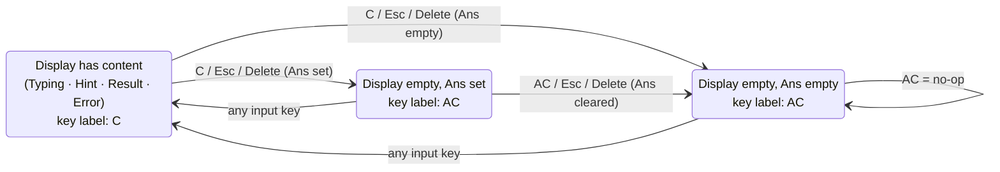
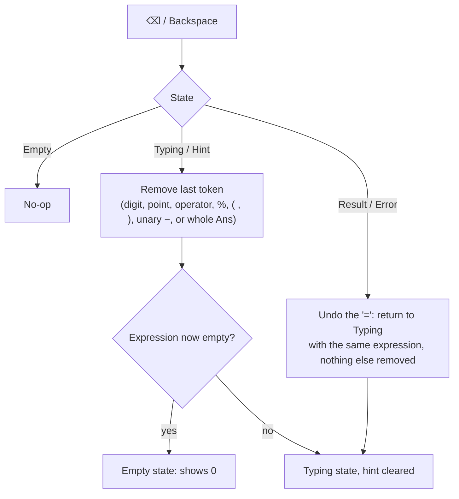
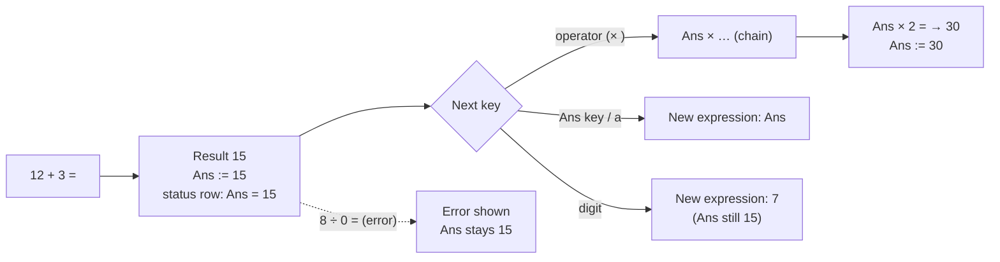

# R1 · #2 Clear, backspace and reuse last result — UX/UI spec

| | |
|---|---|
| Issue | [chjort/calculator-web#2](https://github.com/chjort/calculator-web/issues/2) · Milestone R1 – Core calculator |
| Builds on | [R1-1-basic-arithmetic.md](R1-1-basic-arithmetic.md): page shell, display, keypad grid, tokens, contrast, focus, keyboard model (§2–§3, §7–§8 there) |
| Owner | Designer (UX) · Design **approved by PO (2026-10-18)**, see §11 Decisions |
| Accessibility target | **WCAG 2.2 AA is the bar** (PO decision D7, 2026-10-18) |
| Scope | Behaviour, UI and copy of **C / AC**, **⌫ Backspace** and **Ans**. No implementation or architecture choices. |

---

## 1. User flows

### 1.1 Clear (one key, two levels)


Press once: clear the display. Press again: also forget Ans ("all clear").

### 1.2 Backspace



### 1.3 Reuse the last result (Ans)



---

## 2. Wireframes

### 2.1 Desktop: Ans set, result shown (key reads **C**)

```
┌────────────────────────────────────────────────────────────────────┐
│ ▣ Calculator                                    [ account slot R2 ]│
├────────────────────────────────────────────────────────────────────┤
│        ┌──────────────────────────────────┐   ┊ history slot R3    │
│        │ Ans = 15                         │◄─ status row, 14px secondary
│        │                         12 + 3 = │                        │
│        │                               15 │                        │
│        ├────────┬────────┬────────┬───────┤                        │
│        │   C    │   (    │   )    │   ⌫   │◄─ function keys (row 1)│
│        ├────────┼────────┼────────┼───────┤                        │
│        │   7    │   8    │   9    │   ÷   │                        │
│        │  …     │        │        │       │                        │
│        ├────────┼────────┴────────┴───────┤                        │
│        │  Ans   │           =             │◄─ Ans bottom-left      │
│        └────────┴─────────────────────────┘                        │
└────────────────────────────────────────────────────────────────────┘
```

### 2.2 Mobile: first use, Ans empty (key reads **AC**; Ans is aria-disabled)

```
┌──────────────────────────────┐
│ ▣ Calculator                 │
├──────────────────────────────┤
│                              │ ← status row reserved (20px), empty
│                              │
│                            0 │
├───────┬───────┬───────┬──────┤
│  AC   │   (   │   )   │  ⌫   │
├───────┼───────┼───────┼──────┤
│   7   │   8   │   9   │  ÷   │
│  …    │       │       │      │
├───────┼───────┴───────┴──────┤
│┆ Ans ┆│          =           │ ← dashed border, text-secondary
└───────┴──────────────────────┘
```

### 2.3 Mobile: Ans pressed while empty (transient hint)

```
│                              │
│                              │
│   ⓘ No previous result yet   │ ← result line hint, 16px secondary; leaves on next key
```

### 2.4 Mobile: Backspace after an error

```
 before ⌫                         after ⌫
│                  8 ÷ 0 =  │   │                    8 ÷ 0 │ 32px primary
│ ⚠ Error: Can't divide by  │   │                          │
│   zero                    │   │                          │
```

---

## 3. Component spec

All keys use R1-1 §3.3 sizes and states. They are **function** keys: bg #E1E4E8, text #1A1D21 (13.26:1), border #767D88 (3.73:1).

| Key | Position | Visible label | Accessible name | Notes |
|---|---|---|---|---|
| Clear | row 1, col 1 | `C` or `AC` (§1.1) | `Clear` (C) / `All clear` (AC) | Label and name swap together. The key width is fixed so the grid never shifts |
| Backspace | row 1, col 4 | ⌫ icon (24px, `aria-hidden`) + tooltip "Backspace" | `Backspace` | `title` is not relied on. The name comes from `aria-label` |
| Ans | row 6, col 1 | `Ans` | `Ans, insert last result` when set (status row shows the value) / same name + `aria-disabled="true"` when empty | Stays focusable when disabled (dashed border, text #4A5260 = 6.17:1) |

**Status row** (display row 1, R1-1 §3.2): `Ans = {value}` at 14px/400 text-secondary (7.08:1), left-aligned. Height is reserved even when empty, so the layout never jumps. The value uses R1-1 §3.5 formatting. It is not a live region. Its content is read with the display group in browse mode.

**Ans token in the expression**: it is rendered as the literal text `Ans` (same weight as the numbers) and behaves as one token for editing.

---

## 4. States

| # | State | Clear key | Ans key | Status row | Notes |
|---|---|---|---|---|---|
| A1 | Empty, Ans empty (first load) | `AC` (press = no-op) | aria-disabled | (empty) | |
| A2 | Typing, Ans empty | `C` | aria-disabled | (empty) | |
| A3 | Result shown | `C` | enabled | `Ans = 15` | Ans updates on every successful `=` |
| A4 | Empty, Ans set (after C) | `AC` | enabled | `Ans = 15` | next AC forgets Ans → A1 |
| A5 | Typing with Ans | `C` | enabled | `Ans = 15` | e.g. `Ans × 2` |
| A6 | Error, Ans set | `C` | enabled | `Ans = 15` (unchanged) | errors never change Ans |
| A7 | Error, Ans empty | `C` | aria-disabled | (empty) | e.g. the very first calc is `8 ÷ 0` |
| A8 | Hint "No previous result yet" | unchanged | aria-disabled | (empty) | hint clears on next key |
| A9 | Backspace after result | `C` | enabled | `Ans = 15` (kept) | returns to Typing `12 + 3` |

---

## 5. Edge cases

| Case | Behaviour |
|---|---|
| C while typing | the expression is cleared → Empty; Ans kept |
| C in Result / Error | display cleared → Empty; Ans kept |
| AC (display already empty) | Ans forgotten → A1. If Ans is already empty: no-op |
| Esc pressed twice | same as C then AC → full reset |
| Backspace on empty | no-op |
| Backspace multi-digit | `123` → `12` → `1` → Empty (shows `0`) |
| Backspace an operator | `12 +` → `12` |
| Backspace an implicit × | `2 × (` → `2 ×` → `2` (implicit × is a real character once inserted) |
| Backspace an Ans token | `5 × Ans` → `5 ×`: the whole token at once (D9) |
| Backspace an auto-prefixed `0.` | `0.` → `0` → Empty |
| Backspace after result | "undo `=`": `12 + 3 =` / `15` → typing `12 + 3`. Ans stays 15 (it was computed). A second ⌫ → `12 +` |
| Backspace after auto-closed parens | `(1 + 2) =` → typing `(1 + 2)`: the auto-closed `)` is now part of the input |
| Backspace after error | undo `=`: `8 ÷ 0`, ready to fix |
| Backspace in Hint | removes the last token and the hint (`3 +` → `3`). The incomplete attempt was already saved to history as an error entry when `=` was pressed (R3 forward requirement, D3). Backspace does not remove it |
| Ans when empty | no-op + hint "No previous result yet" + announcement |
| Ans after digit / `)` / Ans | implicit ×: `5` → `5 × Ans` · `Ans` → `Ans × Ans` |
| Digit / `(` / `.` after Ans | implicit ×: `Ans × 5`, `Ans × (`, `Ans × 0.` |
| Ans in Result state | starts a new expression `Ans` |
| Operator in Result state | starts `Ans op` (chaining); same in Error state if Ans is set |
| Ans after error | Ans is the last **successful** result, never an error |
| Ans precision | Ans stores the full-precision result. The status row shows it rounded to 12 sig. digits (R1-1 §3.5) |
| Ans negative | `Ans = −7`; `5 − Ans` → 12 |
| Reload page | Ans is not kept in R1 (D11) |

---

## 6. UI copy

| Element | Visible | Accessible name / announcement |
|---|---|---|
| Clear key (content) | `C` | name `Clear` · on press: "Cleared" |
| Clear key (empty) | `AC` | name `All clear` · on press: "All cleared. Last result removed." |
| Backspace key | ⌫ | name `Backspace` · on press: "Deleted {spoken token}", e.g. "Deleted 3", "Deleted plus", "Deleted Ans". When the expression empties: "Deleted 3. Empty." |
| Backspace after result/error | — | "Editing {spoken expression}" |
| Ans key | `Ans` | name `Ans, insert last result` · on press: "Ans" (and implicit × if any: "times, Ans") |
| Ans empty hint | ⓘ No previous result yet | "No previous result yet" |
| Status row | Ans = 15 | (not live; read in browse mode as "Ans = 15") |
| Shortcut list (in R1-1 "Keyboard shortcuts") | `Esc` / `Delete` Clear · `Backspace` Delete last · `A` Ans | — |

---

## 7. Keyboard

| Key | Action | Notes |
|---|---|---|
| `Backspace` | ⌫ | the browser's autorepeat on hold is fine (one announcement per deletion, polite queue) |
| `Escape` | C, then AC on the second press | |
| `Delete` | same as `Escape` | |
| `a` / `A` | Ans | only while focus is inside the calculator (2.1.4, R1-1 §8.5) |
| `Space` / `Enter` on a focused key | Space activates the key; Enter = equals (R1-1 §7.1, D5) | |

The pressed on-screen key flashes its Pressed state for 100ms when a hardware key is used. There is no flash under reduced motion beyond the instant state change.

---

## 8. Accessibility notes

1. All three are native `<button type="button">` with stable accessible names. The C↔AC swap changes both label and `aria-label` together, focus stays on the key, and the result is announced (4.1.2).
2. Ans uses `aria-disabled="true"` (not the `disabled` attribute), so keyboard and screen-reader users can still reach it and hear *why* nothing happens.
3. Disabled state is shown with a dashed border and secondary text, plus the status row being empty. It is not colour alone (1.4.1).
4. Every action announces through the single `role="status"` polite region from R1-1 §8.2. The visible display updates at the same time.
5. Icon-only ⌫ has an accessible name and a visible tooltip on hover/focus. The tooltip can be dismissed with Esc without moving focus and stays while hovered (1.4.13). Esc closes the tooltip first, if one is open, before acting as Clear.
6. Targets ≥ 56×56px. Reduced motion, zoom 200% and 320px reflow are as in R1-1 §8. The status row wraps rather than truncating `Ans = 1.23456789012e+15`.
7. No time limits. The "No previous result yet" hint stays until the next key; it does not auto-dismiss on a timer.

---

## 9. Acceptance-criteria mapping (#2)

| AC (#2) | Covered by | Notes |
|---|---|---|
| A clear (C/AC) action resets the current expression | §1.1 flow, §3 Clear key, §4 A1/A4, §5 C/AC rows, §6 copy | two-level C → AC (**D8**) |
| Backspace removes the last entered character | §1.2 flow, §3, §5 Backspace rows, §6 | Ans token deleted whole (**D9**); after result or error = undo `=` (**D10**); after an incomplete `=` the history error entry stays (**D3**) |
| The last result can be inserted into a new expression (e.g. an Ans key) | §1.3 flow, §2.1–2.3, §3 Ans + status row, §4 A1–A9, §5 Ans rows | page-only in R1, per profile from R2 (**D11**); history stores the substituted value (**D12**) |
| All actions available via both keyboard and mouse | §7 keyboard, R1-1 §7, §8 | |

---

## 10. Open questions

None. All resolved by the PO on 2026-10-18 (§11).

## 11. Decisions (approved by PO, 2026-10-18)

| # | Topic | Decision |
|---|---|---|
| D8 | C vs AC | One key on two levels. **C** clears the display and keeps Ans. Pressed again as **AC**, it also forgets Ans. Esc and Delete do the same |
| D9 | "Last entered character" | `Ans` is deleted as one token. Every other token is one character |
| D10 | Backspace after a result or error | "Undo `=`": the expression comes back for editing, and nothing else is removed |
| D11 | Ans lifetime | In memory for the page only in R1 (lost on reload). From R2, Ans is per active profile, so switching profile clears it |
| D12 | History of Ans expressions (R3 #6) | Saved entries store the substituted value (`15 × 2`, not `Ans × 2`). The live display may still show `Ans` |
| D1–D7 | Shared decisions | See R1-1 §11. This includes **D3**: `=` on an incomplete expression shows "Finish the expression" **and** is saved to history as an error entry (R3 forward requirement), and **D7**: WCAG 2.2 AA is the bar |

## 12. History notes: forward requirements for R3

- C, AC and Backspace never create, change or delete history entries.
- Backspace after an error or an incomplete attempt (D10) edits the live expression only. The error entry saved at `=` (roadmap Decision 4 / D3) stays in history.
- Ans never takes its value from an incomplete attempt or an error. It stays the last successful result.
- Ans is substituted with its value when an entry is saved (D12).
- Full table: R1-1 §12.
