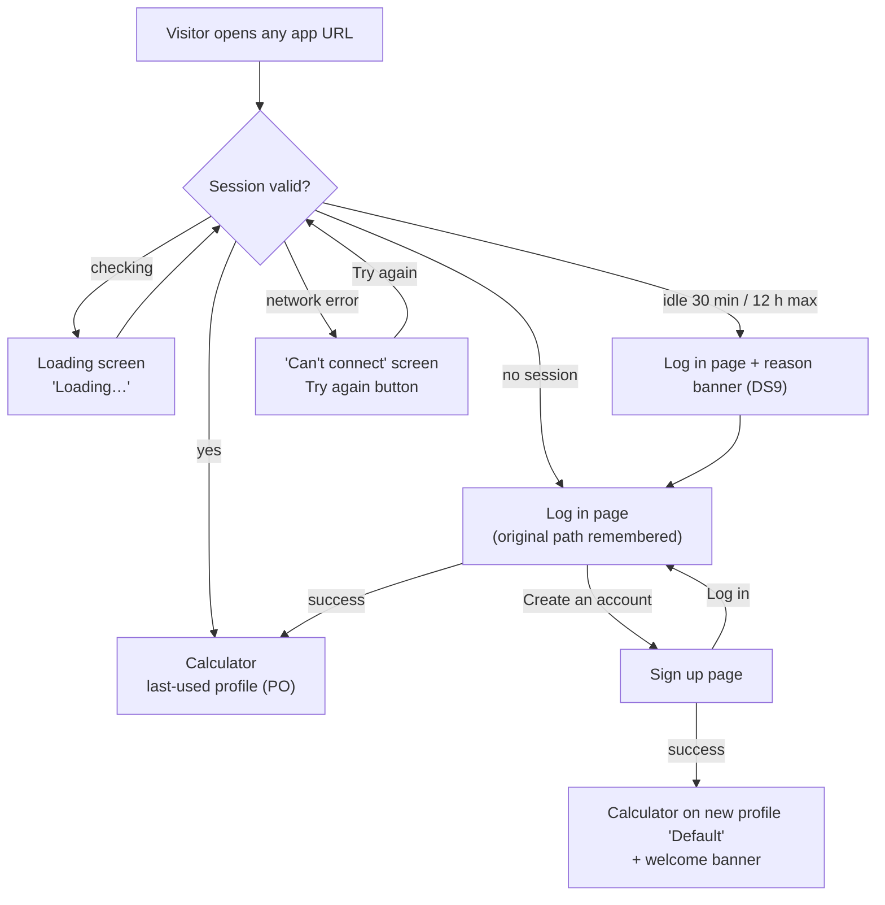
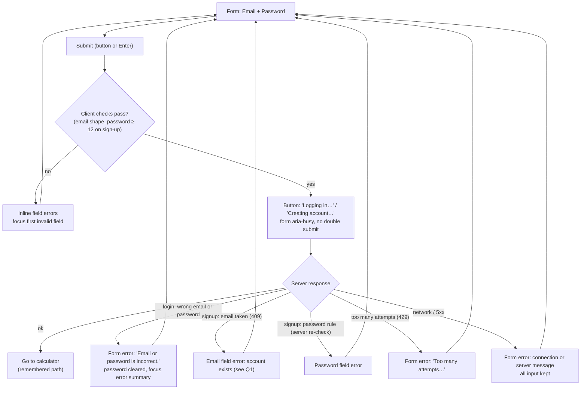
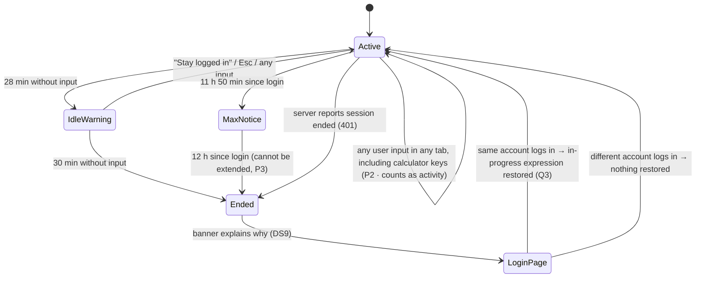
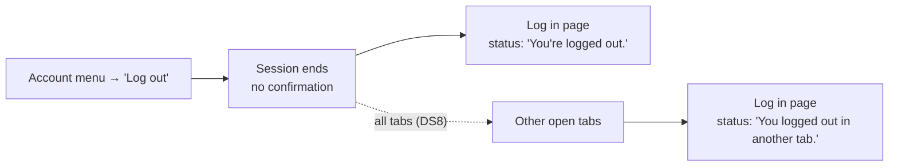

# R2 · #3 Sign up, log in and log out — UX/UI spec

| | |
|---|---|
| Issue | [chjort/calculator-web#3](https://github.com/chjort/calculator-web/issues/3) · Milestone R2 – User profiles |
| Companion spec | [R2-4-profiles.md](R2-4-profiles.md) (#4: profiles, switcher, settings, themes) |
| Builds on | R1 specs in `docs/design/R1/`: page shell and reserved header slot (R1-1 §2.4), tokens (R1-1 §3.4), focus ring, single `role="status"` region, label-in-name rule (D13) |
| Owner | Designer (UX) · Status: **In Review** |
| Accessibility target | **WCAG 2.2 AA** (D7). This spec relies especially on 3.3.1, 3.3.3, 3.3.7, 3.3.8 and 2.2.1 |
| Context (read-only) | `docs/ARCHITECTURE.md`, ADR 0003, and the R2 architecture proposal PR #17 (`docs/architecture/R2.md`, ADR 0005 credential policy, ADR 0006 profile limits). Architecture owns sessions, hashing (argon2id), throttling (5 failures per email per 15 min → 429) and the API. This spec designs only behaviour and UI |
| Decisions | PO and Designer decisions are in **§11**. They are referenced as P1–P8 (PO) and DS6–DS9 (Designer) |

---

## 1. User flows

### 1.1 Entry and redirect (account always required)



### 1.2 Log in (and sign up), with validation and server outcomes



### 1.3 Session end: 30 minutes idle (P2) or 12 hours maximum (P3)



### 1.4 Log out (and multiple tabs)



---

## 2. Wireframes

### 2.1 Log in: desktop (≥ 1024px)

```
┌────────────────────────────────────────────────────────────────────────────┐
│ ▣ Calculator                                                               │ header 56px, no account slot yet
├────────────────────────────────────────────────────────────────────────────┤
│                                                                            │
│                  ┌──────────────────────────────────────┐                  │
│                  │ ⓘ You were logged out after 30       │◄─ info banner (only when relevant)
│                  │   minutes of inactivity. Log in to   │                  │
│                  │   continue.                          │                  │
│                  ├──────────────────────────────────────┤                  │
│                  │ Log in                         (h1)  │                  │
│                  │                                      │                  │
│                  │ Email                                │                  │
│                  │ ┌──────────────────────────────────┐ │                  │
│                  │ │ name@example.com                 │ │ 48px             │
│                  │ └──────────────────────────────────┘ │                  │
│                  │ Password                             │                  │
│                  │ ┌───────────────────────────┬──────┐ │                  │
│                  │ │ ••••••••••                │ Show │ │ toggle 48×48     │
│                  │ └───────────────────────────┴──────┘ │                  │
│                  │                                      │                  │
│                  │ ┌──────────────────────────────────┐ │                  │
│                  │ │             Log in               │ │ primary, 48px    │
│                  │ └──────────────────────────────────┘ │                  │
│                  │                                      │                  │
│                  │ New here? Create an account          │◄─ link           │
│                  └──────────────────────────────────────┘                  │
│                     card max-width 400px (same as calculator card)         │
└────────────────────────────────────────────────────────────────────────────┘
```
There is deliberately no "Forgot password" link (P5).

### 2.2 Sign up: mobile (320–599px), after a failed submit

```
┌──────────────────────────────┐
│ ▣ Calculator                 │
├──────────────────────────────┤
│ Create account          (h1) │
│                              │
│ Email                        │
│ ┌──────────────────────────┐ │
│ │ ana@example              │ │ ← 2px error border
│ └──────────────────────────┘ │
│ ⚠ Enter an email address in  │ ← error text, linked via aria-describedby
│   the format name@example.com│
│                              │
│ Password                     │
│ At least 12 characters       │ ← hint (always visible, before input)
│ ┌────────────────────┬─────┐ │
│ │ ••••••             │Show │ │
│ └────────────────────┴─────┘ │
│ ⚠ Password must be at least  │
│   12 characters              │
│                              │
│ ┌──────────────────────────┐ │
│ │      Create account      │ │
│ └──────────────────────────┘ │
│ Have an account? Log in      │
└──────────────────────────────┘
```

### 2.3 Server error and loading states (both forms)

```
 wrong credentials (login)                 loading
┌──────────────────────────────┐          ┌──────────────────────────────┐
│ ┌──────────────────────────┐ │          │ ...                          │
│ │ ⚠ Email or password is   │ │ alert    │ ┌──────────────────────────┐ │
│ │   incorrect.             │ │ box,     │ │ ◌ Logging in…            │ │ aria-disabled,
│ └──────────────────────────┘ │ focus    │ └──────────────────────────┘ │ static ◌ if
│ Log in                       │ here     │                              │ reduced motion
│ Email [ana@example.com     ] │          └──────────────────────────────┘
│ Password [               ]   │ ← cleared
```

### 2.4 Signed-in header: account menu (fills the R1 header-right slot)

```
desktop ≥1024px
┌────────────────────────────────────────────────────────────────────────────┐
│ ▣ Calculator                               [◉ Work ▾]  [👤 Account ▾]      │
└───────────────────────────────────────────────────────────────┬────────────┘
                                                                │ ana@example.com│ (text, not a menu item)
                                                                │────────────────│
                                                                │ Log out        │ menuitem
                                                                └────────────────┘
mobile <600px:  [▣]  [◉ Work ▾]  ············  [👤]  (Account = icon button, name "Account")
```
The profile switcher (`◉ Work ▾`) is specified in R2-4. At ≥ 1024px the R3 history panel still has its reserved space on the right.

### 2.5 Idle warning dialog (desktop and mobile)

```
┌──────────────────────────────────────┐
│ Are you still there?            (h2) │
│                                      │
│ You'll be logged out in 1:47 because │
│ you haven't used the app for a while.│
│                                      │
│ ┌──────────────────┐ ┌─────────────┐ │
│ │ Stay logged in   │ │  Log out    │ │ ← initial focus: "Stay logged in"
│ └──────────────────┘ └─────────────┘ │
└──────────────────────────────────────┘
 modal, centred; mobile: full width minus 16px margins, buttons stacked
```

### 2.5b Maximum-session notice (10 minutes before 12 hours, non-modal)

```
┌──────────────────────────────────────────────────────────┐
│ ⓘ For your security, your session ends at 22:15.         │  top of main, polite status,
│   You'll need to log in again then.                 [✕]  │  dismissible, no timer
└──────────────────────────────────────────────────────────┘
```
The 12-hour limit cannot be extended (P3). See Q2 about WCAG 2.2.1.

### 2.6 Welcome banner after sign-up (top of main, above the calculator)

```
┌──────────────────────────────────────────────────────────┐
│ ⓘ Account created. Your first profile is called          │
│   "Default". [Rename profile]                       [✕]  │
└──────────────────────────────────────────────────────────┘
```
No timer. It stays until the user dismisses it ✕ (name "Dismiss") or uses Rename.

---

## 3. Layout & component spec

### 3.1 Auth page shell
- Same header as R1 (app name only, no account slot). `main` holds one centred card, 400px max wide (as the calculator card), with padding 24px (mobile 16px).
- `<title>`: "Log in – Calculator" / "Create account – Calculator". The h1 matches.
- Theme before login: follows the OS (`prefers-color-scheme`), using the light/dark tokens in R2-4 §3.5. After login, the active profile's theme applies.

### 3.2 Form fields

| Part | Spec |
|---|---|
| Label | visible `<label for>`, 16px/600, text-primary, above the field. Never placeholder-only |
| Hint | 14px text-secondary (7.87:1 on page), under the label, linked via `aria-describedby` |
| Input | 48px tall, 16px text (prevents iOS zoom), 1px border #767D88 (4.15:1 on page), radius 8px. Focus: R1 focus ring (3px #0B57D0, 2px offset) |
| Error | ⚠ icon (`aria-hidden`) + text, 14px/500 #B3261E (6.54:1 on page), under the input. The input gets `aria-invalid="true"`, a **2px** #B3261E border and the error id added to `aria-describedby`. Not colour only: icon, text and thicker border |
| Password toggle | `<button type="button">` inside the field's right edge, 48×48, visible text **Show** / **Hide**. Accessible name `Show password` / `Hide password` (starts with the visible text, D13) |
| Caps Lock note | when Caps Lock is on and the password field has focus: "Caps Lock is on" (14px, text-secondary, in a polite region). Hidden otherwise |

### 3.3 Buttons and links
- Primary button: full width, 48px, bg #0B57D0, white text (6.39:1), 16px/600. Hover #0A4BB5, pressed #083F99.
- While busy: label changes to "Logging in…" / "Creating account…", with a 16px spinner (static icon under reduced motion). The button gets `aria-disabled="true"`, not `disabled`, so focus isn't lost. Repeat submits are ignored.
- Text links: #0B57D0 (6.39:1), underlined always (not colour only).
- Form error box (server errors): bg #FCE8E6, text #8C1D18 (7.74:1), 1px #B3261E border, ⚠ icon. `role="alert"`, `tabindex="-1"`, placed above the h1 inside the card.
- Info banner (timeout, logged out): bg #E8F0FE, text #1A1D21 (14.76:1), ⓘ icon. Rendered in a `role="status"` region.

### 3.4 Account menu
- Button: icon 👤 + visible text "Account" on ≥ 600px, icon-only below 600px. Accessible name `Account` in both cases (label-in-name holds). `aria-haspopup="menu"`, `aria-expanded`.
- Menu: signed-in email as plain text (not focusable, `role="none"` group label), separator, `Log out` (`role="menuitem"`).
- 44×44 minimum target. Menu items 48px tall.

### 3.5 Idle warning dialog
- Modal `role="alertdialog"`, `aria-modal="true"`, labelled by its h2 and described by its body text.
- Countdown `m:ss` updates visibly each second but is **not** live. Only the dialog opening is announced (alertdialog). A single extra polite announcement goes out at 0:30: "30 seconds left."
- Shown 2 minutes before the idle logout (DS9; ≥ 20 s required by 2.2.1). "Stay logged in" counts as activity, as does any input (P2). It can be extended any number of times. It is not shown for the 12-hour limit, which uses the non-modal notice §2.5b instead, because it cannot be extended.
- **Multiple tabs:** the warning appears in every open tab. Activity in any tab closes it in all tabs (DS8).

---

## 4. States

| # | State | What the user sees | Announced |
|---|---|---|---|
| A1 | Checking session | centred "Loading…" (spinner static under reduced motion). No calculator UI before auth is confirmed | "Loading…" (status) |
| A2 | Can't reach server at start | "Can't connect to Calculator. Check your connection and try again." + `Try again` button (focused) | via alert |
| A3 | Log in, empty | form, no errors. Email field focused | page title, field label |
| A4 | Log in, client errors | inline errors. Focus on first invalid field | error text via `aria-describedby` |
| A5 | Submitting | busy button | "Logging in…" |
| A6 | Wrong email or password | form error box (focused), password cleared, email kept | alert text |
| A7 | Too many attempts | form error box | alert text |
| A8 | Network error on submit | form error box. **All input kept, including the password** | alert text |
| A9 | Server error (5xx) | form error box. Input kept | alert text |
| A10 | Sign up, empty | form + password hint | — |
| A11 | Sign up, email taken | Email field error (Q1). Password kept | field error |
| A12 | Sign up, password too short / too long | Password field error. The rule "At least 12 characters" is shown as a hint **before** typing (P1) | field error |
| A13 | Signed up | calculator on profile "Default" + welcome banner (§2.6). Focus on the calculator display (R1 behaviour) | "Account created. Your first profile is called Default." |
| A14 | Logged in | calculator, last-used profile (PO) | "Logged in. Profile: Work." |
| A15 | Idle warning | dialog §2.5 | alertdialog name + description |
| A16 | Idle timeout | log in page + info banner "You were logged out after 30 minutes of inactivity. Log in to continue." (DS9) | status |
| A16b | Maximum session (12 h) | log in page + info banner "Your session ended after 12 hours. Log in to continue." (DS9) | status |
| A16c | Max-session notice | non-modal banner §2.5b, 10 min before the 12 h limit | status |
| A17 | Logged out | log in page + info banner "You're logged out." | status |
| A18 | Logged out in another tab | log in page + "You logged out in another tab." Every tab logs out (DS8) | status |
| A19 | Password visible | field shows text, toggle reads **Hide** | name change "Hide password" is read on focus. The toggle press announces "Password shown" / "Password hidden" |

---

## 5. Edge cases

| Case | Behaviour |
|---|---|
| Email with spaces or capitals | trimmed. Compared case-insensitively. The account menu shows it in lower case |
| Email validation | client: required plus a basic `x@y.z` shape, checked **on submit** and again on blur after the first submit. No validation while typing |
| Password whitespace | never trimmed. Paste allowed. Password managers and autofill allowed (3.3.8). No CAPTCHA puzzle |
| No "confirm password" field | the Show toggle replaces it (3.3.7 redundant entry, fewer errors) |
| Password rules | at least 12 characters (P1), shown as a hint before typing. Up to 128 (ADR 0005). Any characters, including spaces and emoji. No composition rules. Checked on submit and again on blur after the first submit, never while typing |
| Wrong password vs unknown email | identical message and identical timing: "Email or password is incorrect." Never says which was wrong |
| Duplicate sign-up | AC requires a clear error. This conflicts with not revealing which emails have accounts: **Q1** |
| Enter key | submits the form from any field (native form). The calculator keyboard map (R1-1 §7) is inactive on auth pages |
| Double click on submit | second click ignored while busy |
| Back button after logout | shows the log in page, not a cached calculator. The calculator is never rendered without a valid session |
| Deep link while logged out | after login the user returns to the requested app path. Only same-origin app paths are allowed, otherwise `/` |
| Already logged in and opens `/login` | redirected to the calculator |
| Session ends server-side mid-use (401) | same as timeout: log in page + banner. In-progress input handled as below |
| **Unsaved input at timeout or 12 h end** | Recommended (Q3): the unevaluated expression is kept **in this tab's memory only** and restored if the **same account** logs in again in that tab. It is discarded if a different account logs in or the tab is closed. Ans is not lost: it is kept per profile (P4) |
| Unsaved input at logout | discarded (logout is deliberate) |
| Idle warning visible in several tabs | it is shown in every open tab. "Stay logged in" or input in any tab closes it everywhere (DS8) |
| What counts as activity | any key press, click or tap in the app, in any tab. **Calculating counts** (P2): calculator keys keep the session alive even though they don't reach the server in R2. The mechanism belongs to the Architect (R2.md question 3, option b) |
| Maximum session | 12 hours after login the session ends, even if the user is active (P3). A notice appears 10 min before (§2.5b). It ends at the same moment in all tabs |
| Log out in one tab | every tab moves to the log in page (A18, DS8) |
| Log in in one tab while another shows the log in page | the other tab moves to the calculator on its next focus |
| Two devices | each login is independent, with its own active profile (ADR 0003). Logging out on one device doesn't affect the other (**Q4** for "log out everywhere") |
| Warning dialog open when time runs out | dialog closes, A16 |
| Offline at the moment of timeout | client still ends the session locally at 30:00 and shows A16. Server state is authoritative on reconnect |
| Forgot password | **No password reset in R2 and no "Forgot password" link at all** (P5) |

---

## 6. UI copy

| Element | Visible text | Accessible name / notes |
|---|---|---|
| Log in h1 / title | Log in | `<title>` "Log in – Calculator" |
| Sign up h1 / title | Create account | `<title>` "Create account – Calculator" |
| Email label | Email | input `type="email"`, `autocomplete="username"`, `inputmode="email"`, `autocapitalize="none"`, `spellcheck="false"` |
| Password label (log in) | Password | `type="password"`, `autocomplete="current-password"` |
| Password label (sign up) | Password | `autocomplete="new-password"`. Hint **"At least 12 characters"** is always visible under the label, before typing, and linked via `aria-describedby` (P1) |
| Toggle | Show / Hide | `Show password` / `Hide password`. Press announces "Password shown" / "Password hidden" |
| Log in button | Log in · busy: Logging in… | — |
| Sign up button | Create account · busy: Creating account… | — |
| Switch links | New here? **Create an account** · Have an account? **Log in** | link text is only the bold part |
| Email empty | Enter your email address | — |
| Email invalid | Enter an email address in the format name@example.com | — |
| Password empty | Enter your password | — |
| Password too short | Password must be at least 12 characters | P1 |
| Password too long | Password must be 128 characters or fewer | ADR 0005 |
| Wrong credentials | Email or password is incorrect. | generic (no enumeration) |
| Email taken | There's already an account with this email. Log in instead, or use a different email. | "Log in" is a link. Wording depends on **Q1** |
| Too many attempts | Too many attempts. Wait a few minutes and try again. | same text whatever the cause |
| Network | Can't connect. Check your connection and try again. | — |
| Server error | Something went wrong on our side. Try again in a moment. | — |
| Start-up offline | Can't connect to Calculator. Check your connection and try again. · button **Try again** | — |
| Caps Lock | Caps Lock is on | polite |
| Idle timeout banner | You were logged out after 30 minutes of inactivity. Log in to continue. | status (DS9) |
| Max session banner | Your session ended after 12 hours. Log in to continue. | status (DS9) |
| Max session notice | For your security, your session ends at {HH:MM}. You'll need to log in again then. · ✕ | status. ✕ name `Dismiss`. Time is in 24-hour local time |
| Logout banner | You're logged out. | status |
| Other-tab logout | You logged out in another tab. | status (DS8) |
| Idle dialog title | Are you still there? | h2 |
| Idle dialog body | You'll be logged out in {m:ss} because you haven't used the app for a while. | countdown not live |
| Idle buttons | Stay logged in · Log out | — |
| Account button | Account (icon-only < 600px) | `Account` |
| Account menu | {email} · Log out | menuitem `Log out` |
| Welcome banner | Account created. Your first profile is called "Default". **Rename profile** · ✕ | button names `Rename profile`, `Dismiss`. Rename opens the R2-4 rename dialog |
| Loading | Loading… | status |

---

## 7. Keyboard and focus

| Situation | Focus / keys |
|---|---|
| Log in / sign up page opens | focus the Email field (the page's single task). The banner (if any) is announced by its status region |
| Tab order | (banner) → Email → Password → Show → submit → switch link |
| Submit with client errors | focus the **first invalid field**. Its error is read via `aria-describedby` |
| Server error | focus the form error box (`tabindex="-1"`, `role="alert"`). On wrong credentials the password is cleared |
| Show/Hide | Space/Enter toggles. Focus stays on the toggle. The caret position in the field is kept |
| After login / sign up | focus the calculator display (R1-1 §8.4) |
| Account menu | APG menu button: Enter/Space/↓ opens and focuses the first item, ↑/↓ move, Esc closes and **returns focus to the button**, Tab closes |
| Idle dialog | opens with focus on "Stay logged in". Tab is trapped in the dialog. Esc = Stay logged in. On close, focus returns to the element that had it before |
| After logout / timeout | log in page. Focus on Email |
| Calculator shortcuts | inactive while focus is in any form field, menu or dialog (R1-1 §8.5) |

---

## 8. Accessibility notes (WCAG 2.2 AA)

1. **Labels** (1.3.1, 3.3.2): every field has a visible persistent label. Hints are shown before input, not only after an error.
2. **Errors** (3.3.1, 3.3.3): specific, suggest a fix, and are linked to their field. Focus goes to the first problem. Not colour only (icon, text, 2px border).
3. **Accessible authentication** (3.3.8): no cognitive test. Paste and password managers work. `autocomplete` tokens are set (1.3.5).
4. **Redundant entry** (3.3.7): no confirm-password or confirm-email fields. After an error the email is kept. The password is cleared only after wrong credentials (security). After network or server errors it is kept.
5. **Timing** (2.2.1): the idle timeout has a warning 2 min ahead (≥ 20 s), extendable with one action (DS9). The 12-hour maximum (P3) cannot be extended. It gets a 10-minute advance notice, and in-progress input is restored after re-login (Q3). Whether this satisfies 2.2.1 is **Q2**. No auto-dismissing messages anywhere.
6. **Status messages** (4.1.3): banners, busy state and toggle feedback go through polite status regions. Server errors use `role="alert"`.
7. **Label in name** (2.5.3, D13): Show/Hide → "Show password"/"Hide password". "Account", "Log out", "Stay logged in" and "Try again" use their visible text as their name. axe's label-in-name check stays on.
8. **Targets** (2.5.8): inputs and buttons ≥ 48px tall. The toggle is 48×48. Links have ≥ 24px line boxes with spacing.
9. **Reflow / zoom** (1.4.10, 1.4.4): single column from 320px. Long emails wrap (`overflow-wrap: anywhere`) in the account menu.
10. **Contrast**: values in §3 (all ≥ 4.5:1 text, ≥ 3:1 borders and focus). Dark theme: R2-4 §3.5.
11. **Reduced motion**: spinner becomes a static icon, and dialogs appear without animation.
12. **No information leak**: login errors and timing are identical for unknown email and wrong password. Q1 covers sign-up.

---

## 9. Acceptance-criteria mapping (#3)

| AC (#3) | Covered by | Notes |
|---|---|---|
| An account is always required to use the calculator; unauthenticated visitors are redirected to log in / sign up | §1.1 flow, §4 A1–A3, A16–A18, §5 back button / deep link / 401 rows | no calculator UI is rendered before auth. The redirect explains why (DS9): idle (P2) or 12 h (P3) |
| Sign-up with email and password | §1.2, §2.2, §3.2, §4 A10–A13, §6 copy, §7 | ≥ 12 characters, shown before typing (**P1**). The first profile is "Default" with theme System (**DS7**, R2-4) |
| Email addresses are unique (duplicate sign-up shows a clear error) | §1.2 "email taken", §4 A11, §6 "Email taken" | wording vs non-enumeration → **Q1** |
| Passwords are stored hashed (never in plain text) | not UX; ADR 0003/0005 (argon2id). UX side: §5 (never trimmed, never shown back except via the Show toggle). No reset flow, so passwords are never emailed (**P5**) | — |
| Log out ends the authenticated session | §1.3, §1.4, §2.4 account menu, §2.5 idle dialog, §4 A15–A18, §5 timeout / 12 h / multi-tab rows, §7 | logout in one tab logs out all tabs (**DS8**). Sessions also end after 30 min idle (**P2**, with the warning **DS9**) or 12 h (**P3**) |

---

## 10. Open questions for the PO (recommended defaults are in the spec)

- **Q1 Duplicate email vs not revealing accounts.** The AC asks for a clear duplicate error, and R2.md already returns `409 email_taken`. That lets anyone test whether an email has an account. *Recommended:* follow the AC on **sign-up only**: "There's already an account with this email. Log in instead…". Rely on the throttles in ADR 0005. Keep login fully generic. *Alternative* (needs email delivery, not in R2): a neutral "Check your email" message.
- **Q2 12-hour maximum vs WCAG 2.2.1.** 2.2.1 requires that a time limit can be extended, unless it is essential or longer than 20 hours. A hard 12-hour cap is neither, unless the PO treats it as an essential security limit. *Recommended:* the PO records the 12-hour cap as an essential security limit. Keep the 10-minute advance notice and restore in-progress input after re-login (Q3), so the user loses nothing. *Alternative:* let the user extend once by re-entering their password in a dialog.
- **Q3 Unsaved input at idle or 12-hour end.** *Recommended:* restore the in-progress expression after re-login only for the same account in the same tab, otherwise discard. Ans survives anyway (kept per profile, P4).
- **Q4 Other session features.** "Log out on all devices" and "remember me": *recommended:* neither in R2 ("remember me" would conflict with P2/P3).
- **Q5 Out of scope for R2?** Email verification, changing email or password, and deleting an account are not in the ACs and are not designed here. *Recommended:* backlog stories. Note that with no reset (P5), a forgotten password means losing access to the account's profiles.

## 11. Decisions (PO and Designer, 2026-10-18)

| # | Decision | Where applied |
|---|---|---|
| P0 | Login opens the last-used profile | §1.1, §4 A14, R2-4 |
| P1 | Passwords need at least 12 characters. The rule is shown up front, before the user types | §1.2, §2.2, §3.2, §4 A12, §5, §6 |
| P2 | After 30 minutes idle the user must log in again. Calculating counts as activity and keeps the session alive | §1.3, §2.5, §4 A15–A16, §5 activity row |
| P3 | A session lasts at most 12 hours | §1.3, §2.5b, §4 A16b–A16c, §5, §8.5, Q2 |
| P4 | Ans is kept per profile | §5 unsaved input, R2-4 §5 |
| P5 | No password reset in R2: no "Forgot password" link at all | §2.1, §5, §9 |
| P6 | At most 10 profiles per account | R2-4 |
| DS6 | Profile deletion: permanent, always confirmed, active profile deletable, last profile not | R2-4 |
| DS7 | First profile "Default", theme System | §4 A13, R2-4 |
| DS8 | All tabs share the active profile and re-read it on focus. A switch in another tab shows a polite notice. Logout in one tab logs out every tab | §1.4, §2.5, §4 A18, §5, R2-4 |
| DS9 | The log-in screen explains why the user was sent there (idle or 12 h copy). Idle warning dialog 2 min before, with "Stay logged in" (2.2.1) | §1.1, §1.3, §2.5, §4 A15–A16b, §6 |
| R1 D7 / D13 | WCAG 2.2 AA; label in name | §3, §8 |

Screens covered by the R2 specs: **Log in**, **Sign up** (this file), **Profile switcher**, **Profile settings** (R2-4).
