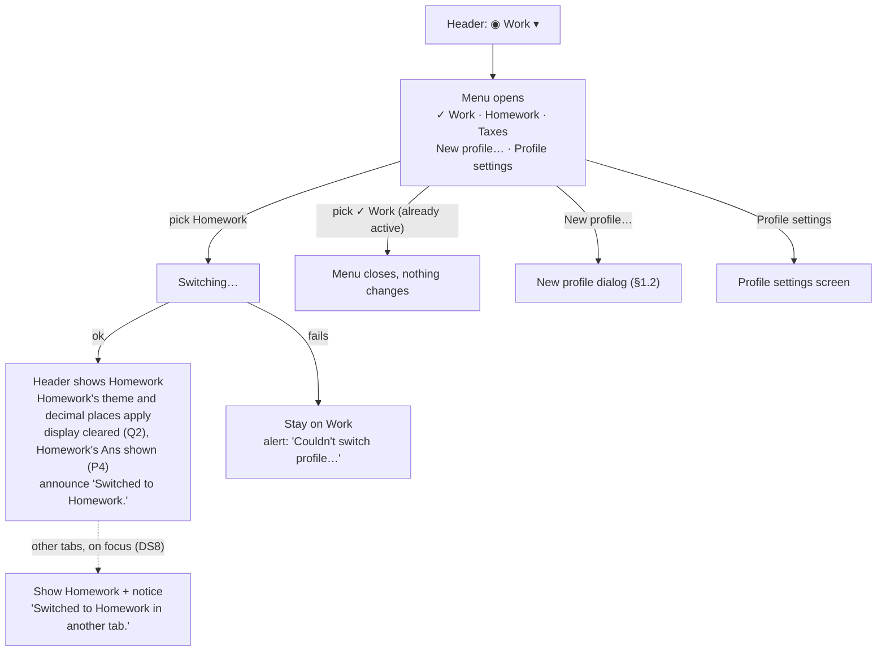
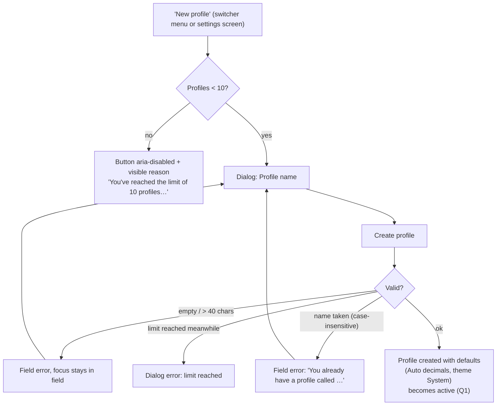
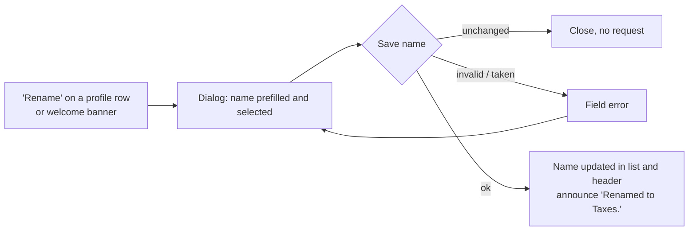
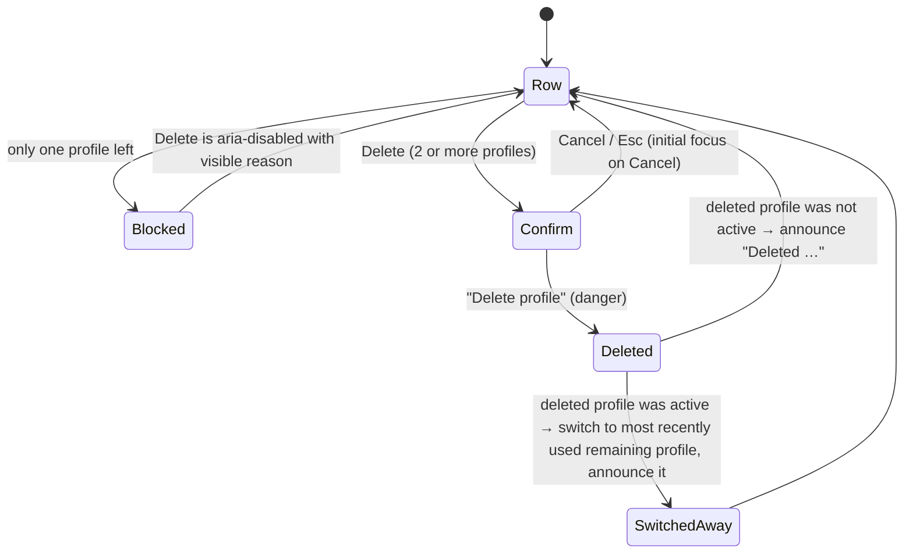
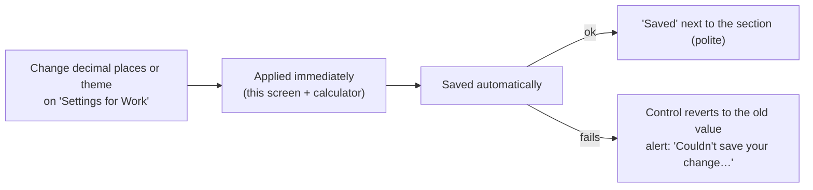

# R2 · #4 Multiple profiles per account — UX/UI spec

| | |
|---|---|
| Issue | [chjort/calculator-web#4](https://github.com/chjort/calculator-web/issues/4) · Milestone R2 – User profiles |
| Companion spec | [R2-3-auth.md](R2-3-auth.md) (#3: sign up, log in, log out, idle and 12-hour session end, account menu) |
| Builds on | R1 specs in `docs/design/R1/`: header slot (R1-1 §2.4), tokens and contrast (R1-1 §3.4), number display D2, Ans (R1-2), label-in-name D13 |
| Owner | Designer (UX) · Status: **In Review** |
| Accessibility target | **WCAG 2.2 AA** (D7) |
| Context (read-only) | `docs/ARCHITECTURE.md`, ADR 0003, R2 architecture proposal PR #17 (`docs/architecture/R2.md`, ADR 0006). Profile names are 1–40 characters, trimmed and unique per account (case-insensitive). `decimal_places` is null (Auto) or 0–12. Theme is light, dark or system |
| Screens | **Profile switcher** (header menu) and **Profile settings** (screen). Log in and Sign up are in R2-3 |
| Decisions | §11. Referenced as P0–P6 (PO) and DS6–DS8 (Designer). They are the same numbers as R2-3 §11 |

---

## 1. User flows

### 1.1 Switch profile (header switcher)



### 1.2 Create profile (limit 10, P6)



### 1.3 Rename profile



### 1.4 Delete profile (DS6)



### 1.5 Change a setting (active profile only)



---

## 2. Wireframes

### 2.1 Header with profile switcher: desktop (≥ 1024px), menu open

```
┌────────────────────────────────────────────────────────────────────────────┐
│ ▣ Calculator                               [◉ Work ▾]  [👤 Account ▾]      │
└──────────────────────────────────────────┬───────────────────────┬─────────┘
                                           │ Profiles              │ group label
                                           │ ✓ Work                │ menuitemradio, checked
                                           │   Homework            │
                                           │   Taxes 2026          │
                                           │───────────────────────│
                                           │ + New profile…        │ menuitem
                                           │ ⚙ Profile settings    │ menuitem
                                           └───────────────────────┘
 menu min-width 240px, max-height 60vh (scrolls); items 48px tall
```

At the limit of 10 profiles, the "New profile…" item looks like this:
```
                                           │ + New profile…        │ aria-disabled, dashed icon
                                           │   Limit of 10 reached │ 14px secondary, aria-describedby
```

### 2.2 Header: mobile (< 600px)

```
┌──────────────────────────────┐
│ [▣] [◉ Homework pr… ▾]   [👤]│  name truncated with … (full name in menu)
└──────────────────────────────┘
 menu opens as a full-width sheet under the header, same items, 48px rows
```

### 2.3 Profile settings screen: desktop

```
┌────────────────────────────────────────────────────────────────────────────┐
│ ▣ Calculator                               [◉ Work ▾]  [👤 Account ▾]      │
├────────────────────────────────────────────────────────────────────────────┤
│   ← Back to calculator                                                     │
│   Profile settings                                              (h1)       │
│                                                                            │
│   ┌──────────────────────────────────────────────────────────────────┐     │
│   │ Settings for Work                                   (h2) ✓ Saved │     │
│   │ These settings apply only to the profile you're using.           │     │
│   │                                                                  │     │
│   │ Decimal places                                                   │     │
│   │ [ Auto (up to 12 significant digits)     ▾ ]                     │     │
│   │ Example: 2 ÷ 3 = 0.666666666667                                  │◄─ live preview
│   │                                                                  │     │
│   │ Theme                                         (fieldset legend)  │     │
│   │ ( ) Light   [▤ swatch]                                           │     │
│   │ ( ) Dark    [▤ swatch]                                           │     │
│   │ (•) System  [▤ swatch]  Follows your device's light or dark mode │     │
│   │                                                                  │     │
│   │ Number format                                    (Q5, proposed)  │     │
│   │ (•) 1234.56   ( ) 1234,56                                        │     │
│   └──────────────────────────────────────────────────────────────────┘     │
│                                                                            │
│   ┌──────────────────────────────────────────────────────────────────┐     │
│   │ Your profiles (3 of 10)                  (h2)  [+ New profile]   │     │
│   ├──────────────────────────────────────────────────────────────────┤     │
│   │ Work          ✓ Active                       [Rename] [Delete]   │     │
│   │ Homework                         [Switch] [Rename] [Delete]      │     │
│   │ Taxes 2026                       [Switch] [Rename] [Delete]      │     │
│   └──────────────────────────────────────────────────────────────────┘     │
└────────────────────────────────────────────────────────────────────────────┘
 content max-width 640px, centred. Settings first, because they are the frequent task
```

### 2.4 Profile settings screen: mobile (320px), single profile left

```
┌──────────────────────────────┐
│ [▣] [◉ Default ▾]        [👤]│
├──────────────────────────────┤
│ ← Back to calculator         │
│ Profile settings        (h1) │
│                              │
│ Settings for Default    (h2) │
│ Decimal places               │
│ [ Auto (up to 12 sig… ▾ ]    │
│ Example: 2 ÷ 3 = 0.6666…     │
│ Theme                        │
│ ( ) Light                    │
│ ( ) Dark                     │
│ (•) System                   │
│   Follows your device's      │
│   light or dark mode         │
│                              │
│ Your profiles (1 of 10) (h2) │
│ [+ New profile]              │
│ ┌──────────────────────────┐ │
│ │ Default  ✓ Active        │ │
│ │ [Rename] [┆Delete┆]      │ │ ← aria-disabled (dashed border)
│ │ You need at least one    │ │ ← visible reason (DS6)
│ │ profile, so this one     │ │
│ │ can't be deleted.        │ │
│ └──────────────────────────┘ │
└──────────────────────────────┘
 row buttons wrap below the name at < 600px; each ≥ 48×48
```

### 2.5 New profile / Rename dialogs

```
┌──────────────────────────────────────┐   ┌──────────────────────────────────────┐
│ New profile                     (h2) │   │ Rename profile                  (h2) │
│                                      │   │                                      │
│ Profile name                         │   │ Profile name                         │
│ Up to 40 characters                  │   │ Up to 40 characters                  │
│ ┌──────────────────────────────────┐ │   │ ┌──────────────────────────────────┐ │
│ │ Homework                         │ │   │ │ ▒Default▒ (selected)             │ │
│ └──────────────────────────────────┘ │   │ └──────────────────────────────────┘ │
│ ⚠ You already have a profile called  │   │                                      │
│   "Homework". Choose a different     │   │                                      │
│   name.                              │   │                                      │
│        [ Cancel ] [ Create profile ] │   │          [ Cancel ] [ Save name ]    │
└──────────────────────────────────────┘   └──────────────────────────────────────┘
```

### 2.6 Delete confirmation (DS6): active profile

```
┌──────────────────────────────────────────┐
│ Delete "Homework"?                  (h2) │
│                                          │
│ This permanently deletes the profile     │
│ "Homework" and its settings. This can't  │
│ be undone.                               │
│                                          │
│ You're using this profile. After         │
│ deleting it you'll switch to "Work".     │ ← only when it is the active profile
│                                          │
│      [ Cancel ]  [ Delete profile ]      │ ← focus starts on Cancel; Delete = danger
└──────────────────────────────────────────┘
 From R3 the first paragraph reads: "…the profile "Homework", its settings and its history. This can't be undone."
```

### 2.7 Other-tab notice (DS8): non-modal, top of main

```
┌──────────────────────────────────────────────────────────┐
│ ⓘ Switched to Homework in another tab.              [✕]  │  polite status, no timer
└──────────────────────────────────────────────────────────┘
```

---

## 3. Layout & component spec

### 3.1 Profile switcher (header, R1 reserved slot)
- APG **menu button**: `<button aria-haspopup="menu" aria-expanded>`. Visible: ◉ icon (`aria-hidden`) + profile name + ▾.
- **Accessible name:** `{name}, switch profile`, for example "Work, switch profile". It starts with the visible text (D13).
- Height 44px, padding 0 12px, max visible name 20ch on desktop and 12ch on mobile, then … The menu shows the full name. Names use `<bdi>` so right-to-left names don't scramble the layout.
- Menu: group "Profiles" with one `menuitemradio` per profile (`aria-checked` on the active one, visible ✓, so it isn't colour only). Profiles are ordered by creation, the same as the settings list. Then a separator, `New profile…` and `Profile settings`.
- `New profile…` at 10 profiles: `aria-disabled="true"`, a visible reason line, and `aria-describedby` pointing to it (P6).

### 3.2 Profile settings screen (`/settings`, no profile id in the URL)
- `<title>` "Profile settings – Calculator", h1 "Profile settings", back link "← Back to calculator" (the name of the link is "Back to calculator").
- **Section A, "Settings for {active name}" (h2):**
  - **Decimal places:** native `<select>`. Options: "Auto (up to 12 significant digits)", then "0", "1" … "12". Hint: "Applies to results and Ans in this profile." Live example line (`aria-live` off, re-read when focused): "Example: 2 ÷ 3 = {formatted}".
  - **Theme:** `<fieldset>` with legend "Theme". Radios: Light, Dark, System. Each has a 48×28 swatch (`aria-hidden`) that shows the page, keypad and equals colours of that theme. System's hint: "Follows your device's light or dark mode".
  - **Number format** (Q5, proposed): radios "1234.56" (accessible name "1234.56, point") and "1234,56" ("1234,56, comma").
  - Auto-save on change. There is no Save button. A "✓ Saved" text (14px, secondary, in a polite region) appears next to the h2 and stays until the next change.
- **Section B, "Your profiles ({n} of 10)" (h2):**
  - `+ New profile` button. At 10 profiles: `aria-disabled` plus visible text "You've reached the limit of 10 profiles. Delete one to add another." (P6).
  - The list is a `<ul>`. Each row: name (`<bdi>`), then "✓ Active" badge on the active row (bg #D6E4FA, text #0B3D91, 7.81:1), then buttons.
  - Row buttons (secondary style, ≥ 48×48). The visible text is short and the name adds the profile (label-in-name holds): `Switch` → "Switch to {name}", `Rename` → "Rename {name}", `Delete` → "Delete {name}". The active row has no Switch.
  - Last profile: Delete is `aria-disabled` with a dashed border, plus the visible reason "You need at least one profile, so this one can't be deleted." linked by `aria-describedby` (DS6).

### 3.3 Dialogs (New profile, Rename, Delete)
- Modal (`aria-modal="true"`), labelled by h2. Max width 440px. Mobile: full width minus 16px.
- Name field: label "Profile name", hint "Up to 40 characters", `autocomplete="off"`, `maxlength` **not** set (so a pasted long name shows an error instead of silently cutting it).
- Delete dialog: `role="alertdialog"`, described by its body. **Delete profile** button bg #B3261E, white text (6.54:1). In dark theme: bg #F2B8B5, text #121417 (10.81:1). The Cancel button is secondary.
- Busy state: the primary button label becomes "Creating…" / "Saving…" / "Deleting…", with `aria-disabled`.

### 3.4 How a settings change shows up
| Change | Calculator | Elsewhere |
|---|---|---|
| Decimal places | the result line and the "Ans = …" row re-format immediately (display only; Ans keeps full precision). The expression line is unchanged (it shows input as typed) | R3 history list will use the same format (forward requirement) |
| Theme | whole app switches tokens immediately. Instant with reduced motion, otherwise a 150ms colour fade | auth screens keep following the device (R2-3 §3.1) |
| Number format (Q5) | the decimal key label becomes `,` (accessible name "Decimal comma") and results show `,`. The keyboard still accepts `.` and `,` (D6) | — |

### 3.5 Theme tokens

The light theme is R1-1 §3.4, unchanged. The dark theme is new; ratios are computed with the WCAG formula.

| Token | Dark hex | Used on | Ratio | AA need | ✓ |
|---|---|---|---|---|---|
| page | #121417 | — | — | — | |
| surface | #1E2126 | — | — | — | |
| text-primary | #E8EAED | page / surface | 15.31 / 13.39:1 | 4.5 | ✓ |
| text-secondary | #AEB4BD | surface | 7.74:1 | 4.5 | ✓ |
| digit key text | #E8EAED | key-digit #2A2E35 | 11.31:1 | 4.5 | ✓ |
| operator text | #D6E4FA | key-op #1F3A66 | 8.81:1 | 4.5 | ✓ |
| function text | #E8EAED | key-fn #353A42 | 9.49:1 | 4.5 | ✓ |
| equals text | #0B1F3F | key-eq #8AB4F8 | 7.77:1 | 4.5 | ✓ |
| equals pressed | #0B1F3F | #AECBFA | 9.92:1 | 4.5 | ✓ |
| digit pressed | #E8EAED | #3A3F47 | 8.79:1 | 4.5 | ✓ |
| Ans aria-disabled text | #AEB4BD | key-fn #353A42 | 5.48:1 | (exempt) | ✓ |
| error text | #F2B8B5 | surface | 9.46:1 | 4.5 | ✓ |
| error banner | #F2B8B5 on #3B1C1B | — | 8.99:1 | 4.5 | ✓ |
| info banner | #E8EAED on #1F2F4A | — | 11.14:1 | 4.5 | ✓ |
| link | #8AB4F8 | page | 8.76:1 | 4.5 | ✓ |
| key / input border | #8A919C | surface / page / key-digit | 5.08 / 5.81 / 4.29:1 | 3.0 | ✓ |
| operator border, equals fill | #8AB4F8 | surface | 7.66:1 | 3.0 | ✓ |
| focus ring | #8AB4F8 | surface / page | 7.66 / 8.76:1 | 3.0 | ✓ |
| active badge | #D6E4FA on #1F3A66 | — | 8.81:1 | 4.5 | ✓ |
| danger button | #121417 on #F2B8B5 | — | 10.81:1 | 4.5 | ✓ |

Light-theme additions for R2 screens: error text on page #B3261E (6.54:1), danger button white on #B3261E (6.54:1), error banner #8C1D18 on #FCE8E6 (7.74:1), info banner #1A1D21 on #E8F0FE (14.76:1), secondary text on page #4A5260 (7.87:1), input border #767D88 on page (4.15:1).

In **forced-colors mode** (Windows high contrast) keys, inputs and badges keep a visible border (`CanvasText`), and the ✓ marks carry the state.

---

## 4. States

| # | State | What the user sees | Announced |
|---|---|---|---|
| B1 | First login after sign-up | one profile "Default", theme System (DS7), welcome banner (R2-3 §2.6) | R2-3 A13 |
| B2 | Login | last-used profile (P0) with its theme, decimal places and Ans (P4). Display empty | "Logged in. Profile: Work." |
| B3 | Switcher closed / open | §2.1, §2.2 | menu button state |
| B4 | Switching | menu closed, the switcher shows a 16px spinner next to the name, `aria-busy` | — |
| B5 | Switched | new name, theme, format and Ans. Display cleared (Q2) | "Switched to Homework." |
| B6 | Switch failed | unchanged + alert | "Couldn't switch profile. Check your connection and try again." |
| B7 | Switched in another tab (DS8) | on focus: new profile applied + notice §2.7 | "Switched to Homework in another tab." |
| B8 | Settings: saved | "✓ Saved" | "Saved" |
| B9 | Settings: save failed | control reverts + alert | "Couldn't save your change. Check your connection and try again." |
| B10 | Profiles 2–9 | full list, New profile enabled | — |
| B11 | Profiles = 10 (P6) | New profile aria-disabled + reason (in the menu and on the screen) | reason via `aria-describedby` |
| B12 | One profile | Delete aria-disabled + reason (DS6) | reason via `aria-describedby` |
| B13 | Create / rename: field error | §2.5 | error via `aria-describedby` |
| B14 | Delete confirm | §2.6, focus on Cancel | alertdialog name + description |
| B15 | Deleted (not active) | row removed, count updated | "Deleted Homework." |
| B16 | Deleted (active) | switched to the most recently used remaining profile (DS6), its theme applied | "Deleted Homework. Switched to Work." |
| B17 | Dark / System theme | §3.5 tokens; System follows the device and changes live if the device changes | — |

---

## 5. Edge cases

| Case | Behaviour |
|---|---|
| Name whitespace | leading and trailing spaces trimmed, inner spaces kept. "   " → "Enter a profile name" |
| Duplicate names | case-insensitive after trimming: "work" is a duplicate of "Work". Renaming a profile to a different case of its **own** name ("work" → "Work") is allowed |
| Name length | 1–40 characters after trimming. More → "Profile name must be 40 characters or fewer". Emoji and any script allowed |
| Rename unchanged | closes the dialog, no request, no announcement |
| Limit of 10 (P6) | New profile is aria-disabled with a visible reason. If another tab or device created the 10th profile meanwhile: dialog error "You've reached the limit of 10 profiles." and the button becomes disabled |
| Delete the last profile | not possible: aria-disabled + reason (DS6). Pressing it does nothing and the reason is announced |
| Delete the active profile | allowed (DS6). The confirmation says which profile you'll switch to. After deletion the app switches to the **most recently used remaining** profile, applies its settings and Ans, and announces it. ⚠ ADR 0006 (proposed) currently rejects this with `409 profile_active`. The Architect needs to support it; the mechanism is theirs (see §12) |
| Delete in one tab, another tab is on that profile | the other tab, on focus, shows the new active profile and the DS8 notice |
| Profile deleted while another **device** uses it | per ADR 0006 that device is logged out. Recommended log-in copy there: "The profile you were using was deleted. Log in to continue." (only if the server can tell this case apart, otherwise the generic R2-3 copy) |
| Switch while typing an expression | display cleared (Q2). The old profile's Ans stays with that profile (P4) |
| Switch back | the profile's own Ans is shown again (P4). Its display starts empty |
| Ans across logins | kept per profile (P4) until AC or deleting the profile (Q3) |
| Settings for a non-active profile | not editable. The heading says "Settings for {active}". To change another profile, switch first. This is how "settings apply only to the active profile" is made visible |
| Settings changed in another tab | applied silently on focus (DS8), no notice |
| Theme preview | choosing a radio applies the theme immediately (that is the preview) and saves it. Choosing again reverts it. Swatches show each theme without having to select it |
| Theme System | follows `prefers-color-scheme` live |
| Decimal places vs the 12-digit rule | see §5.1 |
| Profile names in URLs | never. `/settings` always means the active profile. Profiles can't be linked or shared (roadmap Decision 3) |
| Network loss on any profile action | the action is not applied, input stays in the dialog, an alert appears. No optimistic switch or delete |

### 5.1 Decimal places vs the 12-significant-digit rule (D2)

| Setting | Rule | Examples (setting 2 unless noted) |
|---|---|---|
| Auto (default) | exactly R1 D2: up to 12 significant digits, trailing zeros trimmed, scientific at ≥ 1e12 or non-zero < 1e-6 | `2 ÷ 3` → 0.666666666667 |
| Fixed N (0–12) | round to N decimals, half away from zero. Trailing zeros are **kept** (fixed width is the point of the setting) | `0.1 + 0.2` → 0.30 · `2 ÷ 3` → 0.67 · `−2.345` → −2.35 · N = 0: `2.5` → 3 |
| Fixed N, more than 12 significant digits | never show more than 12 significant digits: decimals = min(N, 12 − integer digits) | N = 4: `123456789.12345` → 123456789.123 |
| Scientific range | D2 thresholds still win. Shown as Auto scientific (N ignored) | `1e15 + 1` → 1e+15 · `1 ÷ 3000000000` → 3.33333333333e-10 |
| Non-zero that rounds to zero | shows the rounded value (Q4) | `0.004` → 0.00 |
| Ans and history | always full precision. Decimal places only affect **display** | Ans after `2 ÷ 3` at N = 2 shows "Ans = 0.67" but `Ans × 3` → 2.00 |

---

## 6. UI copy

| Element | Visible | Accessible name / notes |
|---|---|---|
| Switcher button | ◉ {name} ▾ | `{name}, switch profile` |
| Menu group label | Profiles | — |
| Menu profile item | {name} (✓ when active) | menuitemradio, `aria-checked` |
| Menu actions | + New profile… · ⚙ Profile settings | `New profile…` · `Profile settings` |
| Limit reason (menu) | Limit of 10 reached | `aria-describedby` |
| Settings h1 / title | Profile settings | "Profile settings – Calculator" |
| Back link | ← Back to calculator | `Back to calculator` |
| Section A h2 | Settings for {name} | — |
| Section A intro | These settings apply only to the profile you're using. | — |
| Decimal places | Decimal places · options "Auto (up to 12 significant digits)", "0"–"12" · hint "Applies to results and Ans in this profile." · "Example: 2 ÷ 3 = {value}" | native select |
| Theme | Theme · Light · Dark · System · hint "Follows your device's light or dark mode" | fieldset/legend |
| Number format (Q5) | Number format · 1234.56 · 1234,56 | `1234.56, point` · `1234,56, comma` |
| Saved | ✓ Saved | polite "Saved" |
| Save failed | Couldn't save your change. Check your connection and try again. | alert |
| Section B h2 | Your profiles ({n} of 10) | — |
| New profile button | + New profile | `New profile` |
| Limit reason | You've reached the limit of 10 profiles. Delete one to add another. | `aria-describedby` |
| Active badge | ✓ Active | text, not colour only |
| Row buttons | Switch · Rename · Delete | `Switch to {name}` · `Rename {name}` · `Delete {name}` |
| Last-profile reason | You need at least one profile, so this one can't be deleted. | `aria-describedby` on Delete |
| New dialog | New profile · Profile name · Up to 40 characters · Cancel · Create profile (busy: Creating…) | — |
| Rename dialog | Rename profile · Profile name · Cancel · Save name (busy: Saving…) | — |
| Name empty | Enter a profile name | — |
| Name too long | Profile name must be 40 characters or fewer | — |
| Name taken | You already have a profile called "{name}". Choose a different name. | — |
| Limit (race) | You've reached the limit of 10 profiles. | dialog alert |
| Delete dialog title | Delete "{name}"? | alertdialog label |
| Delete body (R2) | This permanently deletes the profile "{name}" and its settings. This can't be undone. | description |
| Delete body (R3+) | This permanently deletes the profile "{name}", its settings and its history. This can't be undone. | — |
| Delete active note | You're using this profile. After deleting it you'll switch to "{next}". | — |
| Delete buttons | Cancel · Delete profile (busy: Deleting…) | — |
| Announcements | Switched to {name}. · Renamed to {name}. · Created and switched to {name}. · Deleted {name}. · Deleted {name}. Switched to {next}. | polite status |
| Switch failed | Couldn't switch profile. Check your connection and try again. | alert |
| Other-tab notice | Switched to {name} in another tab. · ✕ | polite status; ✕ `Dismiss` |
| Other-device deletion (login page) | The profile you were using was deleted. Log in to continue. | status |

---

## 7. Keyboard and focus

| Situation | Focus / keys |
|---|---|
| Switcher | Enter / Space / ↓ open and focus the **checked** profile. ↑ ↓ move, Home / End jump, typing a letter jumps to the next profile starting with it. Enter selects. Esc closes and **returns focus to the switcher button**. Tab closes the menu |
| After a switch | focus stays on (or returns to) the switcher button. The announcement says what happened |
| Settings screen open | focus the h1 (`tabindex="-1"`) so screen readers get context |
| Settings controls | native select and radio group (arrow keys inside the group). Saving never moves focus |
| Open a dialog | New / Rename: focus the name field (Rename: text selected). Delete: focus **Cancel** (DS6). Tab and Shift+Tab are **trapped** in the dialog |
| Submit a dialog with an error | focus stays on the name field, and the error is read via `aria-describedby` |
| Close a dialog (Esc, Cancel, success) | focus **returns to the button that opened it**. After a delete that button is gone: focus moves to the "Your profiles" h2 (`tabindex="-1"`) and the announcement says what happened |
| aria-disabled buttons | stay focusable. Activating them announces the reason |
| Calculator shortcuts | inactive in the settings screen, menus and dialogs (R1-1 §8.5) |
| No new single-key shortcuts | the R2 features have no single-character shortcuts (2.1.4) |

---

## 8. Accessibility notes (WCAG 2.2 AA)

1. **Menu and dialogs** follow the APG patterns (menu button, `menuitemradio`, modal dialog, alertdialog). The focus trap and return are in §7 (2.4.3).
2. **Label in name** (2.5.3, D13): the switcher reads "{name}, switch profile". Row buttons read "Switch to {name}", "Rename {name}", "Delete {name}". Visible text always comes first. axe's label-in-name check stays enabled.
3. **State is never colour only** (1.4.1): ✓ Active badge, ✓ in the menu, dashed borders and text reasons on disabled actions.
4. **Disabled with reasons**: limit (P6) and last profile (DS6) use `aria-disabled` + visible text + `aria-describedby`, so keyboard and screen-reader users can find out why.
5. **Status messages** (4.1.3): switch, rename, create, delete, saved and the other-tab notice go through polite status regions. Failures use `role="alert"`. No message disappears on a timer.
6. **Error prevention** (3.3.4): deletion is confirmed, the dialog names the profile, it says it can't be undone, and focus starts on Cancel.
7. **Consistent help and navigation** (3.2.3, 3.2.6): the switcher and account menu are in the same place on every signed-in screen.
8. **Targets** (2.5.8): menu items 48px tall, row buttons ≥ 48×48, header buttons ≥ 44×44.
9. **Reflow** (1.4.10): at 320px the settings screen is one column, row buttons wrap under the name, and long names wrap in lists and are truncated only in the header button (full name in the menu and in the accessible name).
10. **Contrast**: all themes pass (§3.5, R1-1 §3.4), including focus rings, borders and the danger button.
11. **Reduced motion**: theme changes and menus have no animation.
12. **Language and direction**: names are wrapped in `<bdi>`.

---

## 9. Acceptance-criteria mapping (#4)

| AC (#4) | Covered by | Notes |
|---|---|---|
| Create, rename and delete profiles within one account | §1.2–1.4, §2.3–2.6, §3.2–3.3, §4 B10–B16, §5, §6, §7 | at most 10 profiles, New profile disabled with a reason (**P6**). Deletion is permanent, confirmed, the active profile can be deleted (auto-switch), the last one can't (**DS6**). New profile becomes active → **Q1** |
| Switch the active profile at any time | §1.1, §2.1–2.2, §3.1, §4 B2–B7, §5 switch rows, §7 | login opens the last-used profile (**P0**). Tabs share the active profile; notice in other tabs (**DS8**). Each profile keeps its Ans (**P4**). Display on switch → **Q2** |
| Each profile has its own name and settings (decimal places, theme) | §2.3–2.4, §3.2, §3.4, §3.5, §5.1, §6 | first profile "Default", theme System (**DS7**). Decimal places vs 12 digits in §5.1 (**Q4**). Number format (D6) → **Q5** |
| Settings changes apply only to the active profile | §1.5, §2.3 "Settings for {name}", §3.4, §4 B8–B9, §5 "Settings for a non-active profile" | only the active profile's settings are editable, they are applied immediately and saved automatically |
| Profiles are not shareable between accounts | §5 "Profile names in URLs", §3.2 (`/settings` has no id), no share UI anywhere | enforced by architecture (ProfileScope, ADR 0003). Roadmap Decision 3 |

---

## 10. Open questions for the PO (recommended defaults are in the spec)

- **Q1 Does a new profile become active?** *Recommended:* yes, "Created and switched to {name}", because people create a profile in order to use it. *Alternative:* create only, and the user switches.
- **Q2 Display on profile switch.** *Recommended:* clear the display (in-progress expression and result), because they belong to the old profile and from R3 would otherwise be saved to the wrong history. Each profile's Ans is restored (P4).
- **Q3 How long Ans is kept.** P4 says "kept per profile". *Recommended:* stored with the profile, so it survives logout and login and lasts until AC or the profile is deleted. Note: R2.md (PR #17) still says "clear Ans (D11)" on switch. It needs to change so switching back restores the profile's Ans.
- **Q4 Fixed decimal places and tiny values.** With 2 decimals, `0.004` shows `0.00`. *Recommended:* show the honest rounded value, since the user chose fixed decimals. Ans and history keep full precision. *Alternative:* fall back to Auto when a non-zero value would show as zero.
- **Q5 Number format (D6).** R1 D6 deferred locale formatting to R2, but #4 lists only decimal places and theme. *Recommended:* add a third per-profile setting, "Number format: 1234.56 / 1234,56". Default point, no digit grouping, keyboard accepts both. Please confirm it is in R2 scope, otherwise drop §3.2's Number format and the Q5 rows.

## 11. Decisions (PO and Designer, 2026-10-18)

| # | Decision | Where applied |
|---|---|---|
| P0 | Login opens the last-used profile | §4 B2 |
| P2 / P3 | 30 minutes idle (calculating counts as activity), 12 hours maximum session | R2-3 |
| P4 | Ans is kept per profile | §1.1, §4 B2/B5, §5, Q3 |
| P6 | At most 10 profiles per account. "New profile" is disabled and says why | §1.2, §2.1, §3.1–3.2, §4 B11, §5, §6 |
| DS6 | Deleting a profile is permanent and always confirmed. The dialog names the profile, says it can't be undone, has a danger "Delete profile" button, and focus starts on Cancel. The active profile can be deleted; the app then switches to the most recently used remaining profile and announces it. The last profile can't be deleted: the button is disabled with a visible reason | §1.4, §2.4, §2.6, §3.2–3.3, §4 B12/B14–B16, §5, §7 |
| DS7 | The first profile is "Default" (renamable), with theme System, which follows the device's light or dark mode | §4 B1, §1.2 (new-profile defaults use the same theme) |
| DS8 | All tabs share the active profile and re-read it on focus. Another tab's switch shows the new profile and a polite non-modal notice "Switched to {name} in another tab." Logout in one tab logs out every tab (R2-3) | §1.1, §2.7, §4 B7, §5 |
| R1 D2 / D6 / D11 / D13 | 12 significant digits, decimal separator, Ans per profile, label in name | §5.1, Q5, P4, §3, §8 |

## 12. Notes for the Architect (alignment with PR #17, not decided here)

- **Deleting the active profile** (DS6) needs API support. ADR 0006 currently proposes `409 profile_active`.
- **Default theme** of the first profile is System (DS7). The R2.md schema default is `'light'`.
- **Ans per profile** (P4): R2.md's switch flow clears Ans. It should restore the target profile's Ans (Q3).
- **Activity** (P2): calculator input must keep the server session alive (R2.md question 3, option b).
- **Most recently used remaining profile** after a delete is the same rule as login's "last-used" (P0).
